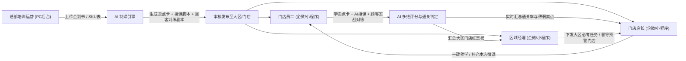
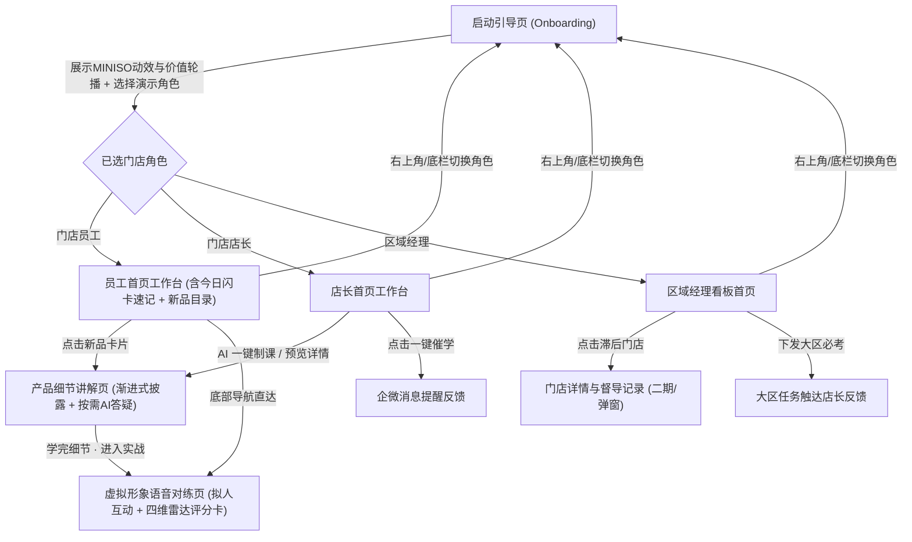

# 产品需求文档（PRD）：名创优品（MINISO）AI 产品授课与导购陪练系统

| 文档属性 | 内容 |
| :--- | :--- |
| **产品名称** | MINISO AI 授课教练（名创优品门店产品培训与话术陪练系统） |
| **文档版本** | v1.0（品牌方案提案 & 高保真演示版） |
| **目标客户** | 名创优品（MINISO）全国及海外直营/加盟门店体系 |
| **产品形态** | 移动端（企业微信自建应用 / 微信小程序）+ PC 端（总部 AI 制课与运营后台） |
| **覆盖角色** | 门店员工（导购）、门店店长、区域经理、总部培训运营 |
| **关联原型** | [index.html](file:///Users/xiaoqi/dev/shouke/index.html)（移动端交互原型） |

---

## 1. 背景与业务目标

### 1.1 行业与名创优品门店痛点
名创优品以「高性价比 + 全球 IP 联名 + 高频上新」为核心竞争力，在门店一线产品培训中面临四大典型挑战：
1. **上新快、SKU 多，传统培训跟不上**：IP 联名（Chiikawa、三丽鸥、迪士尼、哈利波特等）、大师香薰、潮玩盲盒等周度上新，总部发 PDF/长图到微信群，店员「已读不学、学了记不住」。
2. **导购流动率高，话术参差不齐**：门店存在大量新人与周末兼职，面对顾客「嫌贵」「问成分安全」「问盲盒端盒规则」时缺乏标准应答，错失成交与收银连带机会。
3. **制课成本高，内容难下沉**：总部培训师整理一份新品课件、考题与陈列指引耗时数天，难以覆盖所有长尾主推品。
4. **过程黑盒，管理层看不到真实效果**：店长与区域经理只能统计「文档打开率」，无法判断店员是否真正会开口推荐、培训是否带来连带率与客单价提升。

### 1.2 产品定位与核心价值
打造名创优品专属的 **「AI 随身产品教练」**，围绕 **「3 分钟吃透新品卖点 + AI 挑剔顾客开口对练 + 门店通关数据闭环」** 构建新一代零售终端赋能平台：
- **对门店员工**：碎片时间 3 分钟学完新品核心卖点、陈列规范与连带公式，与 AI 模拟顾客无压力反复练话术。
- **对门店店长**：实时掌握全店通关进度与薄弱环节，一键催学、早会抽查，并支持补充本店主推品微课。
- **对区域经理**：一张看板穿透辖区门店红黑榜与品类掌握度，一键下发大区必考任务，联动连带率与客单价复盘。
- **对总部培训运营**：上传新品企划书（PDF/PPT/Excel），AI 自动生成微课、卖点卡与对练剧本，制课效率提升 10 倍以上。

### 1.3 建议提案演示 KPI（预期业务指标）
- **制课效率**：单款新品从企划书导入到全员上架 <= 10 分钟。
- **终端覆盖**：重点 IP 新品上市 48 小时内，门店员工通关率 >= 90%。
- **业务转化**：试点门店主推高毛利品类（如大师香薰、IP 盲盒）连带率提升 10%–20%，客单价稳步增长。

---

## 2. 整体架构与业务闭环

### 2.1 四角色业务闭环流程

### 2.2 用户角色与权限矩阵

| 角色 | 登录入口 | 核心使用场景 | 关键权限范围 |
| :--- | :--- | :--- | :--- |
| **门店员工（导购）** | 企微工作台 / 小程序 | 班前、早会、客流低谷期碎片学习与开口对练 | 查看必学新品、查看卖点卡、AI 授课问答、AI 顾客对练、查看个人得分与门店排名 |
| **门店店长** | 企微工作台 / 小程序 | 早会部署、查看本店通关进度、督促未达标员工、补充本店主推微课 | 本店员工学习明细、一键企微催学、移动端 AI 快速制课（仅本店生效）、体验员工课程 |
| **区域经理** | 企微工作台 / 小程序 | 巡店前摸底、周末大促前下发必考任务、关注滞后门店 | 辖区门店通关率与红黑榜、重点品类掌握度、下发大区必考任务与预警督导 |
| **总部培训运营** | PC Web 运营后台 | 每周新品统一制课、审核发布、管理全网知识库与总览数据 | 企划书批量解析制课、商品知识库与话术红线管理、定向下发门店、全局效能报表 |

> **说明（演示态 vs 生产态身份机制）**：
> - **提案演示版**：在移动端引导页保留 **「门店员工 / 门店店长 / 区域经理」一键角色选择与切换**，便于向名创优品高层及业务方完整演示三端视角。
> - **正式生产版**：接入企业微信 OAuth / 通讯录组织架构，员工进入自动识别门店与岗位角色，无需手动选角（保留多角色账号的视角切换入口）。

---

## 3. 移动端信息架构与页面流转

---

## 4. 核心功能详细需求

### 4.1 移动端：引导页（Onboarding）
- **目标**：建立名创优品品牌归属感，清晰传达产品价值，并在演示版中完成「进入首页前的门店角色选择」。
- **视觉与动效要求**：
  - 品牌红渐变背景叠加 **MINISO 品牌矢量背景动效**（经典红白购物袋轮廓、Wink 眨眼笑脸徽章、IP 盲盒礼盒、柔和光环脉冲动画）。
  - 顶部 3 页价值亮点自动/手动轮播：`01 闪卡速记`、`02 虚拟语音对练`、`03 四维雷达评估`。
- **正下方横向 3D 滚轮式角色选择器（进入首页前）**：
  - 采用 **横向 3D 滚轮轮盘动效**（中心卡片高亮居中、左右相邻角色卡片 3D 倾斜透视缩略），内置 **门店员工**、**门店店长**、**区域经理** 三个身份。
  - 支持左右滑动（触屏滑动/鼠标拖拽）、直接点击左右卡片或下方圆点、以及滚轮左右切换角色，主按钮动态回显当前身份并直接进入对应工作台首页。

### 4.2 移动端：门店员工端（对标 Axonify / YOOBIC / Attensi 重构）

#### 4.2.1 员工首页工作台（紧凑首屏 + 五态任务机 + 闪卡）
- **紧凑顶部状态栏**：将门店、班次与身份合并单行展示，连续学习天数、训练积分与门店排名压成单行不折行激励条，缩短首屏头部占用；右上角保留唯一「切换角色」演示入口。
- **今日必练主卡（五态动态状态机）**：按商品持久化学习进度，主卡精确区分并驱动下一步动作：
  - `待学习`（按钮：`开始学习`）→ `学习中`（如已学 1/3 节，按钮：`继续学习` 直达未学章节）→ `待对练`（细节 3/3 已学完，按钮：`去对练`）→ `未通关`（对练未达 85 分，按钮：`去对练`）→ `今日必练已完成`（全部商品通关后切换绿色完成态，提供 `复习课程` / `复练语音`）。
- **今日新品闪卡速记模块（直接内置于首页）**：
  - 面向早会与碎片时间的高频记忆入口，内置 **3D 翻转记忆卡**（采用原生可聚焦 `<button>` 控件支持键盘空格/回车翻面，自适应高度，单行筛选胶囊）。
  - **正面**呈现高频门店考点/顾客疑问；**背面**呈现标准答案与口语化口诀；底部「需再巩固 / 已掌握 · +10 分」在标准移动视口首屏完整可点。
- **今日店面实操执行清单（学用闭环）**：将陈列与试样规范转化为早班/午间店面动作打卡（如核对入口堆头拆封样品、更换试闻扩香石），打通「学完即用」。
- **本周必学新品与完整积分榜**：各商品卡片同步显示实时章节进度与对应动作，页尾保留门店完整积分榜单。

#### 4.2.2 产品细节讲解页（渐进式披露 Progressive Disclosure）
- **页面边界原则**：本页**仅专注产品细节讲解**，不堆砌闪卡或语音对练等跨任务模块，避免同一屏信息重复与认知过载。
- **三层渐进式披露结构**：
  1. **第一层（核心锚点）**：顶部紧凑展示商品品类图标、名称、核心标签、零售价与 3 步讲解进度指示器。
  2. **第二层（分步卡片精讲）**：将产品知识拆分为 3 个独立章节——`01 核心卖点与材质`、`02 黄金陈列与试样动作`、`03 收银连带与异议应答`。默认仅展开当前步骤，用户阅读完点击「继续下一节」逐层解锁（或点击任意章节标题按需展开/收起），每节配备 AI 讲师语音朗读按钮与精炼记忆口诀。
  3. **第三层（按需追问 AI 讲师）**：页面下方提供轻量「还有疑问？问问 AI 讲师」交互区，点击推荐问题胶囊或输入自定义问题时才展开问答气泡，避免未提问前出现大片空白聊天区。
- **自然下一步引导**：底部固定主按钮「学完细节 · 去和虚拟顾客语音对练」，平滑流转至独立的虚拟对练页。

#### 4.2.3 虚拟形象语音对练与四维雷达评分页（独立实战页）
- **商品切换栏**：顶部支持快速切换待对练的新品。
- **虚拟顾客形象互动舞台**：
  - 根据商品客群动态匹配名创优品风格拟人虚拟顾客（学生党、宝妈、上班族），配备矢量拟人形象、情绪状态标签（犹豫顾虑中 / 认真倾听中 / 认可满意）、说话时的**动态口型与声波光环动画**以及实时字幕。
  - 支持开启/关闭浏览器原生语音播报（TTS）与重听提问。
- **语音与文字双模态作答**：
  - 主操作为**点击开始语音对练**（优先调用 Web Speech API 语音识别；无麦克风环境自动提供语音波形采集演示与高分/普通对比语料一键模拟），同时支持展开文字输入。
- **四维雷达评分卡（SVG 可视化）**：
  - 对练提交后即时生成**四维能力雷达图（满分 100 分，>= 85 分通关）**：
    1. `卖点准确度 (35%)`：是否命中正版授权、核心材质、价格/规格等关键事实。
    2. `异议化解力 (30%)`：是否正面消解顾客核心顾虑。
    3. `连带引导力 (20%)`：是否引导体验样品、端盒优惠或推荐关联凑单品。
    4. `服务亲和度 (15%)`：语气是否热情、轻快、符合名创优品门店礼仪。
  - **评分卡构成**：SVG 四维雷达多边形 + 四项分值明细 + 最弱维度提分建议 + 金牌示范话术（支持语音朗读）+「再练一轮」。

### 4.3 移动端：门店店长端
1. **本店培训与连带概览**：展示全店新品通关率、已通关人数、待补考人数、培训后连带率提升趋势。
2. **AI 一键生成本店微课（轻量移动端制课）**：
   - 店长输入商品名称、粘贴商品卖点或拍照识别包装/企划单 -> AI 自动拆解为标准卖点卡 + 授课开场 + 1 套顾客对练题 -> 一键推送至本店所有员工的必学目录。
3. **店员通关明细与一键催学**：
   - 列表展示本店每位员工（早班/晚班/兼职）的通关状态、AI 对练得分及**具体薄弱项**（如「香薰安全话术未命中」）。
   - 点击「一键催学」调用企业微信应用消息推送未通关员工，页面即时更新状态为「已催学」。
4. **早会 5 分钟 AI 抽查助手（提案亮点）**：
   - 一键生成当日早会 3 个高频抽查问题及标准答案，辅助店长线下带教。

### 4.4 移动端：区域经理端
1. **大区培训总览看板**：管辖门店总数、员工总人数、大区整体通关率、100% 达标门店数、滞后预警门店数、训后连带客单价。
2. **重点品类 / IP 专项掌握度**：条形进度直观对比重点系列（如 Chiikawa 盲盒、大师香薰、三丽鸥配件）的大区通关进度。
3. **辖区门店红黑榜与预警督导**：
   - 突出展示标杆门店（高通关率 + 高连带率，形成正向标杆）与滞后预警门店（低通关率 + 具体滞后班次/品类）。
   - 支持「一键下发大区必考指令」：定向选择重点商品与截止时间，自动触达辖区所有店长及门店员工。

### 4.5 PC 端：总部培训运营后台（管理与制课中心）
1. **AI 制课工厂（核心生产力模块）**：
   - **资料导入**：支持上传新品企划 PPT/PDF、SKU 明细 Excel、卖点文档或粘贴文本。
   - **AI 结构化拆解**：自动提取商品基础属性（SKU 编码、零售价、核心卖点、成分/材质、陈列位、连带商品），并生成：
     - 标准知识卡
     - AI 讲师授课脚本
     - 3 类典型顾客画像及刁钻提问剧本
     - 评分关键词与红线规则（如禁止医疗功效宣称、价格不可报错）
   - **人工审校与定向发布**：培训师微调确认后，按大区/门店等级（黑金店、旗舰店、标准店）定向发布，支持设置「必考截止时间」。
2. **商品知识库与话术红线管理**：
   - 集中维护 IP 授权话术规范、合规禁语词库（如香薰/美妆避免夸大功效），确保 AI 授课与评分 100% 符合品牌法务要求。
3. **组织架构同步（企微集成）**：
   - 同步大区 -> 门店 -> 岗位（经理/店长/员工）关系，自动处理新入职与离职员工权限。
4. **全网培训效能分析大屏**：
   - 按大区、门店、新品品类统计上架后 24h/48h/72h 通关曲线、全网高频失分话术 Top 10（反哺总部优化企划卖点），并支持导出 Excel 报表。

---

## 5. AI 能力与防幻觉设计规范

1. **知识边界严格受控（RAG + 结构化知识卡锚定）**：
   - AI 讲师回答价格、成分、折扣、陈列规范时，**必须严格引用后台已发布的商品知识卡**；遇到知识库未覆盖的门店特殊活动，明确回复「请以本店实际陈列及收银系统为准」，严禁编造价格、材质或促销规则。
2. **评分可解释性**：
   - AI 顾客对练得分必须拆解为清晰的命中项、缺失项与示范话术，避免只给一个「黑盒分数」，确保员工服气且知道如何改。
3. **低延迟交互体验**：
   - 授课与对练对话采用流式输出（SSE），首字响应时间目标 <= 1.5s；语音对练场景支持实时语音转写展示。

---

## 6. UI/UX 视觉与交互规范

结合名创优品全球品牌视觉体系（MINISO Brand Identity）与移动端可读性标准：
1. **品牌色彩体系**：
   - 主品牌红：`#ED1C24`（深红渐变 `#CC121A`，浅红高亮底 `#FFF1F2`），仅用于品牌视觉锚点、核心 CTA 与重点数值强调。
   - 中性基础色：画布灰 `#F7F8FA`、纯白卡片 `#FFFFFF`、主文字炭黑 `#1A1A1A`、辅助文字 `#4E5969`。
   - 语义状态色：通关绿 `#00A854`（浅底 `#E8F8F0`）、提醒橙 `#D46B08`（浅底 `#FFF7E6`）。
2. **字号与无障碍底线**：
   - **严禁使用过小字号与禁用缩放**：全端所有文字（含标签、状态徽章、底部导航）最小不低于 **`12px`**；正文 **`14px`**；卡片标题 **`16px`**；一级标题 **`20px–22px`**。禁止限制视口缩放，关键交互卡片采用原生 `<button>` 支持键盘聚焦与翻面操作。
3. **图标规范**：
   - **全面禁用系统 Emoji**，统一使用 `1.8px–2.2px` 描边的极简线性矢量 SVG 图标，并融入 MINISO 购物袋与 Wink 笑脸品牌图形。
4. **空间布局与导航**：
   - 严格遵循 8pt/4pt 间距网格（页面边距 `14px–16px`，卡片圆角 `16px–24px`，主按钮高度 `40px–50px` 全圆角胶囊），底部采用近底端居中**毛玻璃悬浮胶囊导航栏**（精简为「首页」「AI 对练」2 格，适配 `env(safe-area-inset-bottom)` 与底部 `88px+` 安全滚动区），保证单手拇指触控舒适度。

---

## 7. 分期建设规划（Roadmap）

| 阶段 | 目标定位 | 核心交付物 |
| :--- | :--- | :--- |
| **Phase 0：方案提案与原型演示（当前）** | 对齐品牌方需求，呈现完整业务闭环与高保真移动端体验 | 1. 本 PRD 文档 2. 移动端高保真交互原型（引导页选角 + 三端首页 + AI 授课/闪卡速记/虚拟形象语音对练与四维雷达评分卡） 3. 总部 PC 制课后台概念原型（待补充） |
| **Phase 1：试点门店 MVP 上线（4–6 周）** | 跑通 10–30 家标杆门店真实新品培训闭环 | 1. 企微自建应用 / 小程序（三端角色权限自动同步） 2. 接入真实大模型 SSE 流式授课 + 语音/文字顾客对练与四维评分 3. PC 运营后台（PDF/Excel 上传 AI 制课、审核发布、数据导出） |
| **Phase 2：规模化推广与业务数据打通** | 全国门店推广，验证培训对业绩的直接贡献 | 1. 对接企业 ERP/商品主数据，新品入库自动触发制课 2. 对接门店 POS 销售数据，自动关联「员工通关率 vs 品类连带率/客单价」 3. 新增**AI 拍照陈列验收**（店员拍货架照，AI 核对拆封样品与黄金视线位）与多语言海外门店版 |

---

## 8. 默认假设与待确认事项

因前期沟通中以下两项尚未指定，本版本 PRD 已按**最契合名创优品零售场景的推荐方案**纳入设计，后续可按实际预算灵活增减：
1. **AI 交互形态**：默认一期包含「图文卖点卡 + AI 授课答疑 + 语音/文字双模态顾客对练」，将「AI 拍照陈列验收」纳入二期规划。
2. **内容生产方式**：默认以「总部 PC 后台上传企划书 AI 批量制课」为主，保留「门店店长移动端快速补充本店微课」作为灵活补充，ERP 自动对接纳入二期。
