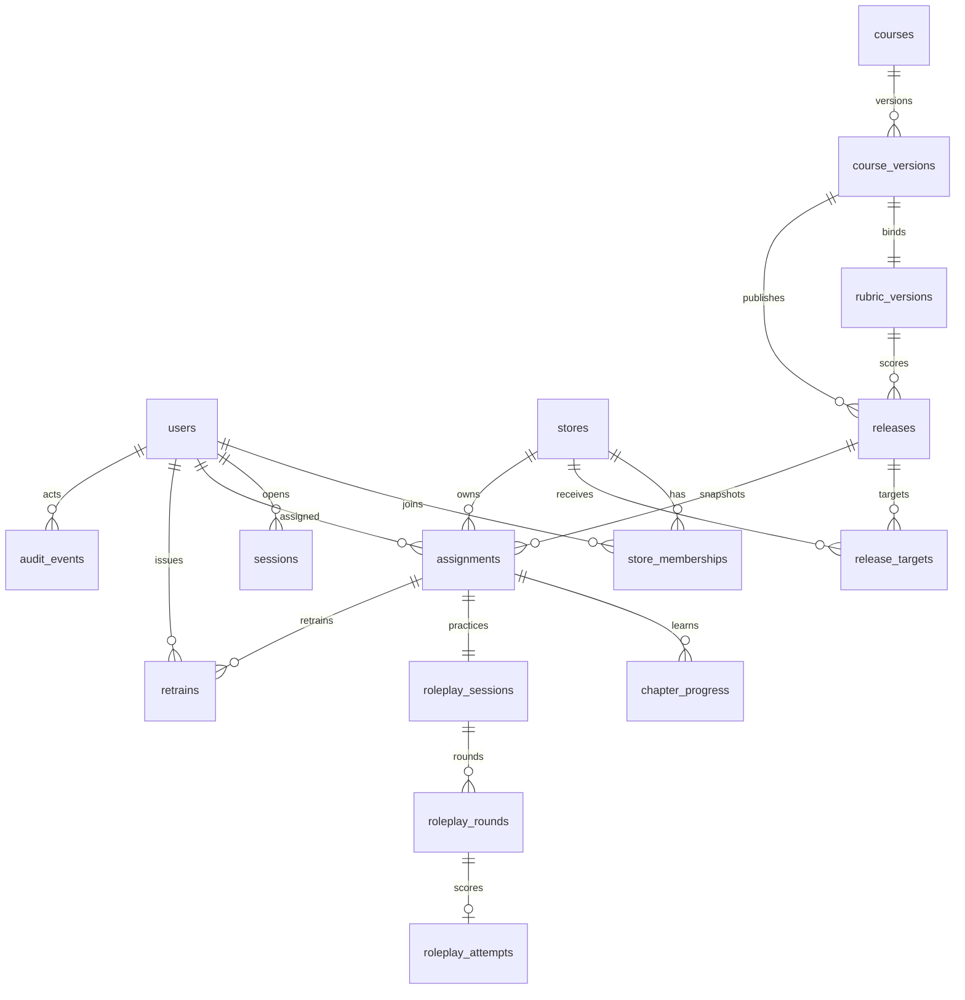
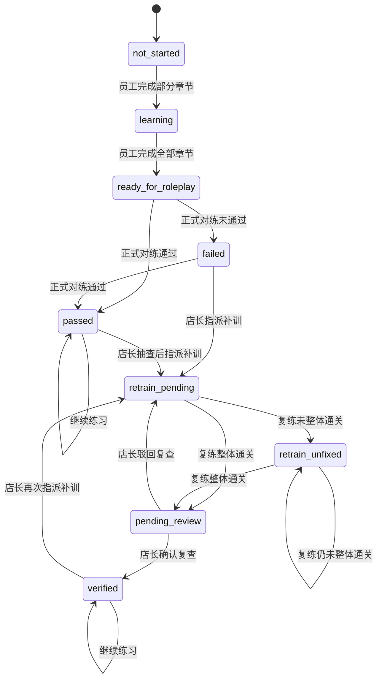

# M1 身份、业务状态与接口契约

| 项目 | 内容 |
| --- | --- |
| 版本 | v1.0（2026-11-23，Codex 验收定稿） |
| 适用里程碑 | M1 本地三角色闭环 |
| 承接 | QoderCN 起草；跨端决策与定稿由 Codex 负责 |
| 上游依据 | [PRD](../../../PRD.md) · [静态原型](../../../static/app.js) · [工程化验收约定](../../../AGENTS.md) · [任务卡](../tasks/T001-contract.md) |
| 状态 | 已定稿；前后端按本契约实现，变更须提升契约版本并同步任务卡 |

本文使用「必须」「不得」表示契约要求，「应当」表示默认实现方式。接口字段统一使用 `snake_case`，时间统一为 UTC ISO 8601（毫秒精度，带 `Z`），角色、状态、错误码统一使用固定英文枚举。

---

## 1. 范围

### 1.1 M1 必须覆盖

| 能力 | 说明 |
| --- | --- |
| 身份与会话 | 总部、店长、员工三种角色；开发身份登录；服务端会话；门店与数据范围鉴权 |
| 审校与发布 | 课程草稿、评分规则版本、总部人工审校、定向门店发布、应训名单快照 |
| 员工学习 | 已发布课程读取、章节进度写入、刷新后继续 |
| 文字对练 | 已保存轮次恢复、正式评分、命中与漏讲证据、重复提交幂等 |
| 补训与复查 | 店长按漏讲项指派补训、员工复练推进状态、店长确认或驳回、审计记录 |
| 48 小时统计 | 按发布批次与应训名单快照计算通关率，含两家门店示例 |
| 读模型 | 员工首页任务、店长门店进度、总部发布结果与统计 |

### 1.2 M1 明确不做

以下能力不进入本契约，前端不得为此依赖接口；需要时按 M2 任务卡另立契约。

- 企业微信 OAuth、通讯录同步、正式环境扫码登录（M1 只保留开发身份入口）。
- 语音识别、语音播报、SSE 流式回复（M1 对练为文字提交与一次性评分）。
- 区域经理角色、区域看板、大区必考下发。
- 店长移动端自制微课、总部资料文件解析（M1 总部直接录入结构化课程）。
- 积分、排行榜、闪卡、店面实操打卡、早会抽查、企微催学与消息推送。
- 商品知识库问答、陈列拍照验收、POS/ERP 对接。

> 原型中的上述能力用于核对交互方向，不作为 M1 接口范围。前端若保留入口，必须标注「M2」或隐藏。

---

## 2. 关键决策摘要

下表是本契约中会影响前后端实现的跨端决策。Codex 定稿时逐项确认；如需改判，必须提升契约版本并同步更新前端 Mock、后端迁移与任务卡。

| 编号 | 决策 | 理由 |
| --- | --- | --- |
| D1 | 角色固定为 `staff`、`store_manager`、`hq_ops`；员工和店长必须有门店成员关系，总部不需要 | 对齐 M1 三角色验收，避免客户端自报角色 |
| D2 | 开发身份通过 `POST /auth/dev-login` 换取服务端会话；生产环境该路由不注册，且 `APP_ENV=production` 时禁止开启开发登录 | 正式环境隔离，防止测试入口泄漏 |
| D3 | 课程版本与评分规则版本一经审校即不可变；重新编辑必须新建版本；发布批次永久绑定发布时的版本与应训名单快照 | 保证已发布内容、成绩与统计可追溯 |
| D4 | 正式对练要求先学完全部章节；章节完成只能由学习动作写入，对练和评分不得改动章节进度 | 修复原型中「直接对练导致章节变成 3/3」的混写问题 |
| D5 | 正式通关条件为：总分不低于 85、无话术红线、所有必考事实逐项命中；漏任一必考事实即未通关（一票否决） | 对齐 PRD 的必考事实与红线要求 |
| D6 | 同一学员同一发布批次最多一条进行中的补训；补训考点只能是最近一次正式成绩中漏讲的必考事实；复练成绩必须整体通关才进入待复查 | 让补训、复查证据、通关资格与状态推进一致可核验 |
| D7 | 48 小时指标按发布批次计算：分母为应训名单快照，分子为窗口内首次正式通关人数，窗口为左闭右开；空名单比率为 `null` | 成员名单变化、重复对练、复查确认时间不得改变历史统计 |
| D8 | 成功响应直接返回资源对象；错误统一为 `error` 包装；发布、补训、复查使用 `Idempotency-Key`，对练轮次使用 `client_round_id`；成功重放保持首次 HTTP 状态码 | 重复提交返回同一结果，冲突可识别 |
| D9 | 示例话术评分使用不落库的预览接口，不写入成绩、补训、资格时间或统计 | 修复原型中「演示样例写入正式成绩」的问题 |
| D10 | API 字段使用 `snake_case`；前端 TypeScript 类型保持同名，不做自动驼峰转换 | 降低 FastAPI、数据库与前端之间的映射成本 |

---

## 3. 身份、角色与权限

### 3.1 角色与门店归属

| 角色 | 枚举值 | 门店归属 | M1 可见范围 |
| --- | --- | --- | --- |
| 员工 | `staff` | M1 恰有一个有效 `store_memberships`，角色为 `staff` | 仅本人被快照进应训名单的发布批次 |
| 店长 | `store_manager` | 至少一个 `store_memberships`，角色为 `store_manager` | 本人管辖门店的发布批次、进度、补训与复查 |
| 总部运营 | `hq_ops` | 无门店成员关系 | 全部课程、发布批次与统计；不写学习与补训数据 |

> 原型中的 `store_mgr` 在契约中统一写为 `store_manager`，其他角色名不变。

M1 账号固定单一角色；`users.role` 必须与该用户每条有效 `store_memberships.role` 一致。总部账号不得有门店成员关系。M1 允许店长管理多个门店，但员工只能有一个有效门店成员关系。发布批次可以面向多个门店；跨店员工成员关系属于后续范围，避免同一员工在一个发布批次生成多个应训记录。

### 3.2 权限矩阵

| 能力 | 员工 | 店长 | 总部 |
| --- | --- | --- | --- |
| 读取本人会话与权限 | ✓ | ✓ | ✓ |
| 读取课程草稿、编辑草稿、提交审校、发布 | — | — | ✓ |
| 读取面向本人或本店的已发布课程内容 | 本人应训批次 | 本店发布批次 | 全部 |
| 读取学员进度与对练成绩 | 仅本人 | 本店应训名单 | 全部 |
| 写入章节进度、提交对练 | 仅本人 | — | — |
| 指派补训、确认或驳回复查 | — | 本店发布批次 | — |
| 读取 48 小时统计 | — | 本店发布批次 | 全部 |
| 通过请求体指定操作人、角色或门店 | 禁止 | 禁止 | 禁止 |

鉴权只使用服务端会话中的 `user_id` 与成员关系。请求体出现 `user_id`、`role`、`store_id` 等身份字段时，按 `extra="forbid"` 返回 422，不允许「客户端声称是谁就按谁处理」。

### 3.3 开发身份与门店数据

ID 为不透明字符串，运行时使用带类型前缀的 ULID；开发种子使用下表稳定 ID，便于前后端共用同一组样例。

| 用户 ID | 姓名 | 角色 | 门店 | 用途 |
| --- | --- | --- | --- | --- |
| `usr_linxiaomei` | 林小美 | `staff` | `store_bj` 北京路旗舰店 | 主路径员工 |
| `usr_chenajie` | 陈阿杰 | `staff` | `store_bj` | 补训与复查样例 |
| `usr_wangxiaoxue` | 王晓雪 | `staff` | `store_bj` | 无对练记录、48 小时分母样例 |
| `usr_zhoulin` | 周琳 | `staff` | `store_fs` 佛山祖庙百货店 | 非目标门店隔离 |
| `usr_hejing` | 何静 | `staff` | `store_fs` | 非目标门店隔离、时间边界样例 |
| `usr_liming` | 李明 | `store_manager` | `store_bj` | 主路径店长 |
| `usr_zhangtao` | 张涛 | `store_manager` | `store_bj` | 第二店长账号 |
| `usr_linmin` | 林敏 | `hq_ops` | — | 主路径总部审校人 |
| `usr_zhouyi` | 周毅 | `hq_ops` | — | 第二总部账号 |

### 3.4 登录、登出与当前用户

#### `POST /auth/dev-login`

仅开发环境注册。请求体：

```json
{
  "user_id": "usr_linmin"
}
```

成功响应（`200`，同时下发会话 Cookie）：

```json
{
  "user": {
    "id": "usr_linmin",
    "name": "林敏",
    "role": "hq_ops",
    "stores": []
  },
  "session": {
    "expires_at": "2026-11-23T21:00:00.000Z"
  }
}
```

店长登录时 `stores` 返回成员关系：

```json
{
  "user": {
    "id": "usr_liming",
    "name": "李明",
    "role": "store_manager",
    "stores": [
      {
        "id": "store_bj",
        "name": "北京路旗舰店",
        "role": "store_manager"
      }
    ]
  },
  "session": {
    "expires_at": "2026-11-23T21:00:00.000Z"
  }
}
```

响应头：

```http
Set-Cookie: sk_session=<opaque-token>; Path=/; HttpOnly; SameSite=Lax; Max-Age=43200
```

- 会话有效期 12 小时，采用绝对过期，不做滑动续期。
- 服务端只保存令牌的 SHA-256 哈希；令牌为 32 字节随机值。
- 每次登录生成新令牌，旧会话不自动复用。
- 未启用开发登录或用户不存在时返回 `404 NOT_FOUND`，不暴露开发入口是否存在。

#### `POST /auth/logout`

成功返回 `204`，并清除 Cookie、撤销会话。

#### `GET /me`

```json
{
  "user": {
    "id": "usr_linxiaomei",
    "name": "林小美",
    "role": "staff",
    "stores": [
      {
        "id": "store_bj",
        "name": "北京路旗舰店",
        "role": "staff"
      }
    ]
  },
  "capabilities": [
    "staff.assignment.read",
    "staff.progress.write",
    "staff.roleplay.submit"
  ],
  "server_time": "2026-11-23T10:00:00.000Z"
}
```

`capabilities` 为前端显隐辅助，不作为鉴权依据；后端必须在每个接口重新校验角色与门店范围。

### 3.5 会话、CSRF 与传输

- Cookie 名称固定为 `sk_session`；HTTPS 下必须加 `Secure`；始终 `HttpOnly`、`SameSite=Lax`、`Path=/`。
- 所有写请求必须使用 `Content-Type: application/json`；浏览器请求的 `Origin` 与配置的 `APP_ORIGIN` 不一致时返回 `403 CSRF_ORIGIN_REJECTED`。
- M1 不引入独立 CSRF Token；同域 SPA、`SameSite=Lax` 与 Origin 校验共同防护。跨域或企微 WebView 特殊场景在 M2 重新评估。
- 服务端会话表可被登出、过期或管理员撤销；撤销后立即失效。

### 3.6 正式环境隔离

| 配置 | 开发 | 生产 |
| --- | --- | --- |
| `APP_ENV` | `development` | `production` |
| `DEV_AUTH_ENABLED` | `true` | 必须为 `false` |
| `/auth/dev-login` | 注册 | 不注册，访问返回 404 |
| 种子数据脚本 | 允许 | 拒绝执行 |
| Cookie `Secure` | 按协议 | 强制 |

应用启动时若 `APP_ENV=production` 且 `DEV_AUTH_ENABLED=true`，必须启动失败。M2 接入企微后，OAuth 回调复用同一 `sessions` 表签发 `sk_session`，不改变业务接口的鉴权方式。

### 3.7 未授权响应

| 场景 | HTTP | `error.code` |
| --- | --- | --- |
| 无会话 Cookie、令牌无效 | 401 | `AUTH_REQUIRED` |
| 会话过期、已登出、已撤销 | 401 | `SESSION_EXPIRED` |
| 已登录但角色无权调用该组接口 | 403 | `FORBIDDEN_ROLE` |
| 跨门店访问、非本人任务、草稿或未发布批次 | 404 | `NOT_FOUND` |
| 请求体携带身份覆盖字段 | 422 | `VALIDATION_ERROR` |
| 生产环境访问开发登录 | 404 | `NOT_FOUND` |
| Origin 校验失败 | 403 | `CSRF_ORIGIN_REJECTED` |

对无权资源统一返回 404，避免通过状态码探测其他门店或草稿是否存在。员工访问本店但未被快照进名单的批次，同样返回 404。

---

## 4. 数据模型与发布规则

### 4.1 实体关系



### 4.2 表与约束

以下为 T002 建表的最小字段集。所有表使用 InnoDB、`utf8mb4`，时间为 `DATETIME(3)` 且存 UTC。

#### `stores`

| 字段 | 类型 | 约束 / 说明 |
| --- | --- | --- |
| `id` | varchar(32) | PK，如 `store_bj` |
| `code` | varchar(32) | UNIQUE |
| `name` | varchar(64) | 门店名称 |
| `active` | boolean | 默认 true |
| `created_at` | datetime(3) | 服务端时间 |

#### `users`

| 字段 | 类型 | 约束 / 说明 |
| --- | --- | --- |
| `id` | varchar(32) | PK |
| `name` | varchar(64) | 展示名 |
| `role` | enum | `staff` / `store_manager` / `hq_ops` |
| `wecom_userid` | varchar(128) | NULL，UNIQUE；M2 使用 |
| `active` | boolean | 默认 true |
| `created_at` | datetime(3) | |

#### `store_memberships`

| 字段 | 类型 | 约束 / 说明 |
| --- | --- | --- |
| `id` | varchar(32) | PK |
| `user_id` | varchar(32) | FK users |
| `store_id` | varchar(32) | FK stores |
| `role` | enum | `staff` / `store_manager` |
| `active` | boolean | 默认 true |
| `created_at` | datetime(3) | |
| 唯一键 | — | `(user_id, store_id)` |
| 索引 | — | `(store_id, active, role)` |

#### `sessions`

| 字段 | 类型 | 约束 / 说明 |
| --- | --- | --- |
| `id` | varchar(32) | PK |
| `user_id` | varchar(32) | FK users |
| `token_hash` | char(64) | UNIQUE，SHA-256 十六进制 |
| `created_at` | datetime(3) | |
| `expires_at` | datetime(3) | |
| `revoked_at` | datetime(3) | NULL |
| 索引 | — | `(expires_at)` |

#### `courses`

| 字段 | 类型 | 约束 / 说明 |
| --- | --- | --- |
| `id` | varchar(32) | PK，如 `crs_chiikawa` |
| `sku_code` | varchar(64) | UNIQUE |
| `name` | varchar(128) | 课程名 |
| `created_by` | varchar(32) | FK users |
| `created_at` | datetime(3) | |

#### `course_versions`

| 字段 | 类型 | 约束 / 说明 |
| --- | --- | --- |
| `id` | varchar(32) | PK |
| `course_id` | varchar(32) | FK courses |
| `version_no` | int | 从 1 递增 |
| `status` | enum | `draft` / `approved` / `published` / `superseded` |
| `content` | json | 商品与章节内容，见 6.6.2 |
| `revision` | int | 草稿乐观锁，从 1 递增 |
| `created_by` | varchar(32) | FK users |
| `created_at` | datetime(3) | |
| `updated_at` | datetime(3) | |
| `reviewed_by` | varchar(32) | NULL，FK users |
| `reviewed_at` | datetime(3) | NULL |
| 唯一键 | — | `(course_id, version_no)` |
| 索引 | — | `(status)` |

#### `rubric_versions`

| 字段 | 类型 | 约束 / 说明 |
| --- | --- | --- |
| `id` | varchar(32) | PK |
| `course_version_id` | varchar(32) | FK course_versions，UNIQUE |
| `version_no` | int | M1 固定为 1 |
| `rules` | json | 评分规则，见 8.1 |
| `created_at` | datetime(3) | |

`rubric_versions` 一经创建不可修改；修改评分规则必须新建课程版本。

#### `releases`

| 字段 | 类型 | 约束 / 说明 |
| --- | --- | --- |
| `id` | varchar(32) | PK |
| `course_version_id` | varchar(32) | FK course_versions |
| `rubric_version_id` | varchar(32) | FK rubric_versions |
| `status` | enum | `published` / `closed` |
| `deadline_hours` | smallint | 1–168，任务截止时间用 |
| `deadline_at` | datetime(3) | `published_at + deadline_hours` |
| `published_by` | varchar(32) | FK users |
| `published_at` | datetime(3) | 服务端时间，统计锚点 |
| `created_at` | datetime(3) | |
| 索引 | — | `(course_version_id)`、`(published_at)` |

#### `release_targets`

| 字段 | 类型 | 约束 / 说明 |
| --- | --- | --- |
| `id` | varchar(32) | PK |
| `release_id` | varchar(32) | FK releases |
| `store_id` | varchar(32) | FK stores |
| 唯一键 | — | `(release_id, store_id)` |
| 索引 | — | `(store_id, release_id)` |

#### `assignments`（应训名单快照 + 派生读模型）

| 字段 | 类型 | 约束 / 说明 |
| --- | --- | --- |
| `id` | varchar(32) | PK，如 `asg_...` |
| `release_id` | varchar(32) | FK releases |
| `store_id` | varchar(32) | 冗余，发布时门店 |
| `user_id` | varchar(32) | FK users |
| `assigned_at` | datetime(3) | 等于 `published_at` |
| `status` | enum | 见第 5 节 |
| `completed_chapter_count` | tinyint | 冗余，章节完成时维护 |
| `last_score` | tinyint | NULL |
| `best_score` | tinyint | NULL |
| `last_attempt_at` | datetime(3) | NULL |
| `first_passed_at` | datetime(3) | NULL，首次正式通过 |
| `qualified_at` | datetime(3) | NULL，等于 `first_passed_at`，统计用冗余字段，一旦写入不再回退 |
| `state_version` | int | 默认 1，状态变化时 +1 |
| `updated_at` | datetime(3) | |
| 唯一键 | — | `(release_id, user_id)` |
| 索引 | — | `(store_id, release_id, status)`、`(user_id, release_id)`、`(release_id, qualified_at)` |

#### `chapter_progress`

| 字段 | 类型 | 约束 / 说明 |
| --- | --- | --- |
| `id` | varchar(32) | PK |
| `assignment_id` | varchar(32) | FK assignments |
| `chapter_key` | varchar(32) | 已发布内容中的章节键 |
| `completed_at` | datetime(3) | 服务端时间 |
| 唯一键 | — | `(assignment_id, chapter_key)` |

章节完成是单向事实：写入后不删除、不回退；重复上报返回原记录。

#### `roleplay_sessions`

| 字段 | 类型 | 约束 / 说明 |
| --- | --- | --- |
| `id` | varchar(32) | PK |
| `assignment_id` | varchar(32) | FK assignments，UNIQUE |
| `course_version_id` | varchar(32) | 发布时绑定的课程版本 |
| `rubric_version_id` | varchar(32) | 发布时绑定的评分规则版本 |
| `last_round_no` | int | 默认 0，分配轮次时递增 |
| `created_at` | datetime(3) | |
| `updated_at` | datetime(3) | |

同一学员同一发布批次只有一条会话；刷新或重启后按会话 ID 恢复轮次。

#### `roleplay_rounds`

| 字段 | 类型 | 约束 / 说明 |
| --- | --- | --- |
| `id` | varchar(32) | PK |
| `session_id` | varchar(32) | FK roleplay_sessions |
| `round_no` | int | 从 1 递增 |
| `client_round_id` | char(36) | 客户端 UUID，幂等键 |
| `question_variant` | enum | `default` / `alt` |
| `question_text` | text | 提交时的顾客问法快照 |
| `answer_text` | text | 员工原始文字 |
| `answer_source` | enum | `text`；M2 增加 `voice` |
| `status` | enum | `scoring` / `scored` / `failed` |
| `failure_code` | varchar(64) | NULL 或错误码 |
| `submitted_at` | datetime(3) | 服务端时间 |
| `scored_at` | datetime(3) | NULL |
| 唯一键 | — | `(session_id, round_no)`、`(session_id, client_round_id)` |
| 索引 | — | `(status, submitted_at)` |

#### `roleplay_attempts`（正式成绩，不可变）

| 字段 | 类型 | 约束 / 说明 |
| --- | --- | --- |
| `id` | varchar(32) | PK |
| `round_id` | varchar(32) | FK roleplay_rounds，UNIQUE |
| `assignment_id` | varchar(32) | FK assignments |
| `release_id` | varchar(32) | FK releases |
| `rubric_version_id` | varchar(32) | 评分所用规则版本 |
| `total` | tinyint | 0–100 |
| `passed` | boolean | 见 8.3 |
| `dims` | json | 四维得分与命中证据 |
| `fact_checks` | json | 必考事实逐项结果 |
| `missed_required_facts` | json | 漏讲的必考事实 |
| `missed_facts` | json | 未命中的事实（M1 与必考事实同集） |
| `redline_hits` | json | 红线命中 |
| `evidence` | json | 模型返回并经业务层核验的证据 |
| `computed_at` | datetime(3) | 服务端时间 |
| 索引 | — | `(assignment_id, computed_at)`、`(release_id, passed, computed_at)` |

一条轮次最多一条正式成绩。错误、失败或无效输出不写本表。

#### `retrains`（补训与复查）

| 字段 | 类型 | 约束 / 说明 |
| --- | --- | --- |
| `id` | varchar(32) | PK |
| `assignment_id` | varchar(32) | FK assignments |
| `release_id` | varchar(32) | FK releases |
| `focus_fact_key` | varchar(32) | 必考事实键，如 `fact_box_rule` |
| `focus_fact_label` | varchar(128) | 发起时的展示文案快照 |
| `note` | text | 店长说明，可空字符串 |
| `status` | enum | `pending` / `submitted_unfixed` / `fixed_pending_review` / `verified` |
| `baseline_round_no` | int | 发起时 `roleplay_sessions.last_round_no` |
| `evidence_round_no` | int | NULL，最近一次用于推进状态的轮次 |
| `evidence_attempt_id` | varchar(32) | NULL，待复查依据 |
| `issued_by` | varchar(32) | FK users |
| `issued_at` | datetime(3) | 服务端时间 |
| `updated_at` | datetime(3) | |
| `version` | int | 默认 1，状态变化时 +1，用于复查乐观锁 |
| `reviewed_by` | varchar(32) | NULL，FK users |
| `reviewed_at` | datetime(3) | NULL |
| `review_note` | text | NULL |
| `open_flag` | tinyint generated | `status IN ('pending','submitted_unfixed','fixed_pending_review')` 时为 1，否则 NULL |
| 唯一键 | — | `(assignment_id, open_flag)`；利用 MySQL 允许多个 NULL 实现「最多一条进行中」 |
| 索引 | — | `(assignment_id, issued_at)`、`(status)` |

#### `audit_events`

| 字段 | 类型 | 约束 / 说明 |
| --- | --- | --- |
| `id` | varchar(32) | PK |
| `actor_user_id` | varchar(32) | FK users |
| `action` | enum | `course.reviewed` / `release.published` / `retrain.issued` / `retrain.confirmed` / `retrain.rejected` |
| `entity_type` | varchar(32) | `course_version` / `release` / `retrain` |
| `entity_id` | varchar(32) | 对应实体 ID |
| `store_id` | varchar(32) | NULL，发布或门店操作时填写 |
| `payload` | json | 变更前后、考点、分数、说明 |
| `request_id` | varchar(64) | 服务端请求 ID |
| `created_at` | datetime(3) | 服务端时间 |
| 索引 | — | `(entity_type, entity_id, created_at)`、`(actor_user_id, created_at)` |

审计记录只追加，不更新、不删除。

#### `idempotency_records`

| 字段 | 类型 | 约束 / 说明 |
| --- | --- | --- |
| `id` | varchar(32) | PK |
| `user_id` | varchar(32) | 会话用户 |
| `route` | varchar(128) | 例如 `POST /api/v1/hq/course-versions/{id}/publish` |
| `key_hash` | char(64) | `Idempotency-Key` 的 SHA-256 |
| `request_hash` | char(64) | 规范化请求体的 SHA-256 |
| `status_code` | smallint | 首次响应状态 |
| `response_body` | json | 首次响应体 |
| `created_at` | datetime(3) | |
| `expires_at` | datetime(3) | 默认 24 小时 |
| 唯一键 | — | `(user_id, route, key_hash)` |
| 索引 | — | `(expires_at)` |

### 4.3 版本与发布规则

1. **草稿可变。** `draft` 版本的 `content` 可通过 `PUT` 修改，每次成功修改 `revision + 1`；请求必须携带 `expected_revision`。
2. **审校即冻结。** `POST review` 要求版本为 `draft` 且三项审校清单全部确认；成功后状态为 `approved`，记录 `reviewed_by`、`reviewed_at`，此后内容不可修改。
3. **发布要求已审校。** 首次 `POST publish` 要求版本为 `approved`，成功后状态变为 `published`。该状态的版本可再次发布到其他门店或再次发布同一门店，每次产生新的发布批次；新版本首次发布后被标为 `superseded` 的旧版本不可再新建发布批次。已存在的旧批次仍可读取原版本。
4. **新版本替代。** 需要改稿时，使用 `POST /hq/courses/{course_id}/versions` 从已冻结版本克隆出新 `draft` 版本，`version_no + 1`，并复制评分规则为该新课程版本独立绑定的规则记录。旧版本及其发布批次保持不变。新版本首次发布时，将旧的 `published` 版本标为 `superseded`。
5. **发布快照。** 发布事务内一次性写入：
   - `releases`：`published_at`、`deadline_at`、发布人；
   - `release_targets`：目标门店；
   - `assignments`：目标门店内当前 `active=true` 且成员角色为 `staff` 的全部用户；
   - `audit_events`：发布动作。
   店长与总部不进入应训名单。目标门店没有员工时仍允许发布，生成 0 条 `assignments`。
   若同一员工在本次发布的多个目标门店均有有效成员关系，发布整体拒绝并返回 `422 AMBIGUOUS_STAFF_STORE`；不得部分发布或生成不确定归属的应训记录。
6. **快照不可变。** 发布后新增、离职、调店、改名都不改变 `assignments` 行集合；展示姓名时关联 `users` 当前值，统计与鉴权以 `user_id` 为准。员工离职后仍保留历史行，查询列表时可标注 `user_active=false`。
7. **内容与规则绑定。** `releases.course_version_id`、`rubric_version_id` 写入后不可修改；对练评分必须使用批次绑定的 `rubric_version_id`，不得使用「当前最新版本」。
8. **截止时间。** `deadline_at = published_at + deadline_hours`，由服务端计算，客户端不得传入。`deadline_hours` 只影响任务展示与截止提示，不改变 48 小时统计窗口（见第 7 节）。
9. **草稿隔离。** 草稿、未发布版本、未包含本店或本人的批次，对员工和店长一律返回 404。

### 4.4 服务端时间、ID 与文本

- 应用服务器时钟为唯一权威；数据库存 UTC `DATETIME(3)`，API 输出带 `Z` 的 ISO 8601。
- `published_at`、`deadline_at`、`completed_at`、`computed_at`、`issued_at`、`reviewed_at`、`qualified_at` 均由服务端写入。
- 客户端时间只用于展示倒计时；服务端不信任 `Date`/时间戳类请求字段。
- 运行时 ID 使用「类型前缀 + ULID」，例如 `rls_01J...`、`asg_01J...`；种子数据可用稳定可读 ID。
- 用户输入按纯文本存储与返回；前端必须转义后渲染，不得把接口文本直接当 HTML。

### 4.5 试点数据约定

- 两家门店：`store_bj` 北京路旗舰店、`store_fs` 佛山祖庙百货店。
- 一款新品：`crs_chiikawa`，课程版本 `crv_chiikawa_v1`，评分规则 `rbn_chiikawa_v1`。章节、事实与话术沿用原型 `chiikawa` 内容，必考事实键固定为：
  - `fact_price`：零售价 59 元；
  - `fact_license`：正版联名授权；
  - `fact_box_rule`：端盒 6 个不重复。
- 种子基线只包含**未发布的草稿课程**，不预置发布批次；T008 从总部审校发布开始跑通主路径。
- 测试可额外通过 API 发布到 `store_fs` 或空名单门店，用于隔离、时间边界和空名单用例；这些批次不进入开发种子基线。
- 原型中的积分、闪卡、打卡等状态不迁移、不参与 M1 统计。

---

## 5. 状态机

### 5.1 学员任务状态

`assignments.status` 是服务端根据章节进度、正式成绩和补训记录维护的派生状态，同时作为读模型字段。状态取值：

| 状态 | 含义 | 进入条件 | 主要下一步 |
| --- | --- | --- | --- |
| `not_started` | 待学习 | 0 章节完成、无正式成绩、无补训 | 开始学习 |
| `learning` | 学习中 | 完成 1 至 N-1 章节 | 继续学习 |
| `ready_for_roleplay` | 待对练 | 完成全部章节、无正式成绩 | 去对练 |
| `failed` | 未通关 | 有正式成绩但未通过，且无进行中补训 | 复练 |
| `passed` | 已通关 | 存在通过成绩，且无进行中补训 | 复习或复练 |
| `retrain_pending` | 待补训 | 存在 `pending` 补训 | 去补练 |
| `retrain_unfixed` | 复练未改正 | 存在 `submitted_unfixed` 补训 | 继续补练 |
| `pending_review` | 已改正待复查 | 存在 `fixed_pending_review` 补训 | 等店长复查 |
| `verified` | 复查通过 | 最近一次补训已 `verified`，且无新补训 | 复习或复练 |

派生优先级从高到低：

1. 存在进行中补训（`pending` / `submitted_unfixed` / `fixed_pending_review`）时，按补训状态映射为 `retrain_pending` / `retrain_unfixed` / `pending_review`。
2. 否则若最近一次补训为 `verified`，状态为 `verified`。
3. 否则若 `qualified_at` 非空，状态为 `passed`。
4. 否则若存在正式成绩，状态为 `failed`。
5. 否则按章节完成数映射为 `ready_for_roleplay` / `learning` / `not_started`。

> `verified` 与 `passed` 都是成功态，前端统一归入「已完成」；`verified` 表示经过人工复查。之后继续练习不会把状态改回 `failed` 或 `passed`，只有店长再次指派补训才会转为 `retrain_pending`。

### 5.2 状态迁移



### 5.3 事件与写入方

| 数据 / 状态 | 写入方 | 触发时机 | 事务要求 |
| --- | --- | --- | --- |
| `chapter_progress` | 员工接口 | 员工确认学完一节 | 短事务，唯一键去重 |
| `roleplay_rounds` | 员工接口 | 提交文字作答 | 短事务创建轮次并分配 `round_no` |
| `roleplay_attempts` | 评分服务 | 模型返回且业务层核验通过 | 模型调用在事务外；写成绩在短事务内 |
| `assignments.status`（首次正式通过时同时写 `qualified_at`） | 服务端 | 章节完成、正式评分、补训推进、复查确认 | 与触发动作同一短事务 |
| `retrains.status = pending` | 店长接口 | 指派补训 | 短事务，校验无进行中补训 |
| `retrains.status = submitted_unfixed` / `fixed_pending_review` | 评分服务 | 带补训的正式复练评分完成 | 与正式成绩同一短事务 |
| `retrains.status = verified` | 店长接口 | 确认复查 | 乐观锁 + 证据校验 |
| `retrains.status = pending`（驳回） | 店长接口 | 驳回复查 | 重建基线，保留历史 |
| `releases` / `assignments` | 总部接口 | 审校后发布 | 单事务写批次、门店、名单、审计 |
| `audit_events` | 服务端 | 审校、发布、补训、复查 | 与业务写入同事务 |

### 5.4 并发与过期结果

1. **章节重复上报。** `(assignment_id, chapter_key)` 唯一；重复请求返回原 `completed_at`，`state_version` 不变。
2. **并发轮次。** 提交轮次时对 `roleplay_sessions` 行加锁，读取并递增 `last_round_no`；并发提交获得不同 `round_no`。同一 `client_round_id` 只创建一轮，重复提交返回原轮次。
3. **评分事务边界。** 评分模型调用不在数据库事务内。评分完成后在短事务内写 `roleplay_attempts` 并更新 `assignments`；若该轮已有成绩，直接返回已有成绩。
4. **过期成绩。** 补训只接受 `round_no > baseline_round_no` 且 `round_no >= evidence_round_no` 的轮次推进状态。晚到的旧轮次可以写入成绩，但不得将补训从较新的 `fixed_pending_review` 或 `verified` 回退。
5. **待复查门槛。** 带补训的正式复练只有在**整轮成绩通过**（总分不低于 85、无红线、全部必考事实命中）时才进入 `fixed_pending_review`；仅改正补训考点但仍有其他必考项漏讲时，保持 `submitted_unfixed`。进入 `fixed_pending_review` 时冻结 `evidence_attempt_id`；之后员工继续练习产生的成绩不改变待复查状态与证据。店长只能基于冻结证据确认或驳回。
6. **复查乐观锁。** 确认/驳回必须携带 `expected_version`；更新语句同时校验 `version` 与 `status`，不匹配返回 `409 STATE_CONFLICT`，响应带当前 `status`、`version` 与 `evidence_attempt_id`。
7. **新补训与旧复练。** 店长在 `verified` 后再次指派补训时，`baseline_round_no` 取当前会话 `last_round_no`。此前已提交但评分尚未完成的轮次 `round_no` 不大于基线，不能作为新补训的证据。
8. **驳回。** 驳回复查将状态改回 `pending`，`baseline_round_no` 更新为当前 `last_round_no`，清空 `evidence_round_no` / `evidence_attempt_id`，`version + 1`，保留审计与历史证据。
9. **发布重复提交。** 相同 `Idempotency-Key` 与相同请求体只产生一个发布批次；键不同则视为新的定向发布，允许产生新批次。
10. **状态版本。** `assignments.state_version` 在状态或关键统计字段变化时递增，供前端判断是否需要刷新；不作为唯一并发控制手段。示例中的数值只表示递增关系，不要求等于事件计数，实现必须保证同一任务后续变化的值更大。

### 5.5 与原型五态任务的映射

| 原型状态 | 契约状态 | 首页动作 |
| --- | --- | --- |
| 待学习 | `not_started` | 开始学习 |
| 学习中 | `learning` | 继续学习 |
| 待对练 | `ready_for_roleplay` | 去对练 |
| 未通关 | `failed` | 去对练 |
| 今日必练已完成 | 当前门店全部任务为 `passed` 或 `verified` | 复习课程 / 继续复练 |
| 店长指派补训 / 未改正 | `retrain_pending` / `retrain_unfixed` | 去补练 |
| 已改正待复查 | `pending_review` | 继续冲刺或等待复查 |
| 复查通过 | `verified` | 已完成 |

`GET /staff/assignments` 的排序固定为：存在进行中补训优先，其次 `deadline_at` 升序，再按 `published_at` 升序。前端如需「今日必练」可自行取第一条，但不得改变服务端状态。

---

## 6. API 契约

### 6.1 通用约定

- 基础路径：`/api/v1`。
- 请求与响应：`Content-Type: application/json; charset=utf-8`。
- 成功响应直接返回资源对象或 `{ "items": [...], "next_cursor": null }`，不额外套 `data`。
- 列表默认 `limit=50`，最大 100；`cursor` 为不透明字符串，空表示结束。
- 所有接口都从会话解析身份；路径和请求体不得携带操作人。
- 错误响应统一为：

```json
{
  "error": {
    "code": "STATE_CONFLICT",
    "message": "复查状态已被其他操作更新，请刷新后重试",
    "request_id": "req_01J9Z3K4T5",
    "details": {
      "current_status": "verified",
      "current_version": 4
    }
  }
}
```

`message` 面向用户展示，`code` 用于前端分支，`details` 为结构化补充。响应头回传 `X-Request-Id`。

### 6.2 错误码

| HTTP | `error.code` | 含义 |
| --- | --- | --- |
| 400 | `IDEMPOTENCY_KEY_REQUIRED` | 缺少必需的 `Idempotency-Key` |
| 401 | `AUTH_REQUIRED` | 未登录或令牌无效 |
| 401 | `SESSION_EXPIRED` | 会话过期或已撤销 |
| 403 | `FORBIDDEN_ROLE` | 角色无权调用 |
| 403 | `CSRF_ORIGIN_REJECTED` | Origin 校验失败 |
| 404 | `NOT_FOUND` | 资源不存在或超出角色 / 门店 / 名单范围 |
| 409 | `IDEMPOTENCY_KEY_REUSED` | 相同幂等键用于不同请求体 |
| 409 | `VERSION_CONFLICT` | 课程草稿 `expected_revision` 不匹配 |
| 409 | `VERSION_IMMUTABLE` | 尝试修改已审校或已发布版本 |
| 409 | `STATE_CONFLICT` | 当前状态不允许该操作 |
| 409 | `RETRAIN_EXISTS` | 已存在进行中的补训 |
| 409 | `CHAPTERS_INCOMPLETE` | 未学完章节即创建正式对练会话或提交轮次 |
| 409 | `SCORING_IN_PROGRESS` | 同一轮次已有评分任务在执行 |
| 409 | `EVIDENCE_MISMATCH` | 复查证据与当前待复查证据不一致 |
| 409 | `NO_ATTEMPT` | 学员尚无正式对练成绩，无法指派补训 |
| 422 | `VALIDATION_ERROR` | 字段缺失、类型错误、携带身份字段等 |
| 422 | `UNKNOWN_CHAPTER` | 章节键不在批次绑定的课程版本中 |
| 422 | `REVIEW_CHECKLIST_INCOMPLETE` | 审校清单未全部确认 |
| 422 | `AMBIGUOUS_STAFF_STORE` | 同一员工在本次发布的多个目标门店均有有效成员关系 |
| 422 | `FOCUS_NOT_MISSED` | 补训考点不在最近成绩的漏讲项中 |
| 422 | `FOCUS_NOT_FIXED` | 复查证据未证明目标考点已改正 |
| 422 | `ATTEMPT_NOT_PASSED` | 复查证据未达到整轮通关标准 |
| 502 | `SCORING_INVALID_OUTPUT` | 模型输出无法通过规则核验 |
| 503 | `SCORING_UNAVAILABLE` | 模型调用失败或超时 |
| 500 | `INTERNAL_ERROR` | 未预期错误，凭 `request_id` 排查 |

### 6.3 幂等

需要 `Idempotency-Key` 的接口：

| 接口 | 幂等键 |
| --- | --- |
| `POST /hq/course-versions/{id}/publish` | 请求头 `Idempotency-Key` |
| `POST /manager/assignments/{id}/retrains` | 请求头 `Idempotency-Key` |
| `POST /manager/retrains/{id}/review` | 请求头 `Idempotency-Key` |
| `POST /staff/roleplay-sessions/{id}/rounds` | 请求体 `client_round_id` |

规则：

- 键最长 64 字符，推荐 UUID；作用域为「当前用户 + 方法 + 路径 + 键」。
- 相同键、相同请求体：成功重放返回首次的状态码与响应体，并带 `Idempotent-Replay: true` 响应头；例如首次为 `201`，重放仍为 `201`。
- 相同键、不同请求体：`409 IDEMPOTENCY_KEY_REUSED`。
- `Idempotency-Key` 接口只在业务写入成功时保存幂等结果。并发相同键由数据库唯一键串行化；后到请求等待前一事务提交后重放结果。客户端若等待超时，必须用同一键重试。对练评分中的并发请求使用 `409 SCORING_IN_PROGRESS`，不使用此规则。
- 记录保留 24 小时；业务写入与幂等记录在同一事务提交。
- 对练轮次使用 `client_round_id`，不写入 `idempotency_records`。同一 ID 返回同一轮次和成绩；评分仍在执行时返回 `409 SCORING_IN_PROGRESS`，成功评分的重放响应仍为 `201`，并标记 `replayed=true`。
- 章节完成接口天然幂等（唯一键 + 目标态），不要求幂等键。

### 6.4 接口总表

| 分组 | 方法与路径 | 角色 | 说明 |
| --- | --- | --- | --- |
| 身份 | `POST /auth/dev-login` | 开发 | 开发身份换取会话 |
| 身份 | `POST /auth/logout` | 全部 | 撤销会话 |
| 身份 | `GET /me` | 全部 | 当前用户与能力 |
| 总部 | `GET /hq/courses` | 总部 | 课程列表 |
| 总部 | `POST /hq/courses` | 总部 | 新建课程与草稿版本 |
| 总部 | `GET /hq/courses/{course_id}` | 总部 | 课程与版本详情 |
| 总部 | `POST /hq/courses/{course_id}/versions` | 总部 | 从不可变版本创建新草稿版本 |
| 总部 | `PUT /hq/course-versions/{version_id}` | 总部 | 修改草稿 |
| 总部 | `POST /hq/course-versions/{version_id}/review` | 总部 | 人工审校 |
| 总部 | `POST /hq/course-versions/{version_id}/publish` | 总部 | 定向发布 |
| 总部 | `GET /hq/releases/{release_id}` | 总部 | 发布批次详情 |
| 总部 | `GET /hq/releases/{release_id}/assignees` | 总部 | 批次名单与进度 |
| 总部 | `GET /hq/releases/{release_id}/stats` | 总部 | 48 小时统计 |
| 员工 | `GET /staff/assignments` | 员工 | 本人应训任务 |
| 员工 | `GET /staff/assignments/{assignment_id}` | 员工 | 课程、进度、成绩与补训 |
| 员工 | `POST /staff/assignments/{assignment_id}/chapters/{chapter_key}/complete` | 员工 | 完成章节 |
| 员工 | `POST /staff/assignments/{assignment_id}/roleplay-sessions` | 员工 | 创建或恢复对练会话 |
| 员工 | `POST /staff/assignments/{assignment_id}/roleplay-preview` | 员工 | 示例话术预览评分，不落库 |
| 员工 | `GET /staff/roleplay-sessions/{session_id}` | 员工 | 恢复已保存轮次 |
| 员工 | `POST /staff/roleplay-sessions/{session_id}/rounds` | 员工 | 提交正式对练作答 |
| 店长 | `GET /manager/releases` | 店长 | 本店发布批次 |
| 店长 | `GET /manager/releases/{release_id}` | 店长 | 批次概览 |
| 店长 | `GET /manager/releases/{release_id}/assignees` | 店长 | 本店应训名单与状态 |
| 店长 | `GET /manager/assignments/{assignment_id}` | 店长 | 成绩、证据与补训历史 |
| 店长 | `POST /manager/assignments/{assignment_id}/retrains` | 店长 | 指派补训 |
| 店长 | `POST /manager/retrains/{retrain_id}/review` | 店长 | 确认或驳回复查 |
| 店长 | `GET /manager/releases/{release_id}/stats` | 店长 | 本店 48 小时统计 |

### 6.5 总部接口

#### 6.5.1 `GET /hq/courses`

返回全部课程及最新版本摘要，按 `updated_at` 降序。

```json
{
  "items": [
    {
      "course_id": "crs_chiikawa",
      "sku_code": "MINISO-CHIIKAWA-BOX-01",
      "name": "Chiikawa 联名毛绒公仔盲盒",
      "latest_version": {
        "id": "crv_chiikawa_v1",
        "version_no": 1,
        "status": "draft",
        "revision": 3,
        "updated_at": "2026-11-23T09:30:00.000Z"
      },
      "published_release_count": 0
    }
  ],
  "next_cursor": null
}
```

#### 6.5.2 `POST /hq/courses`

一次创建课程、草稿版本和评分规则版本。成功返回 `201`。

```json
{
  "sku_code": "MINISO-CHIIKAWA-BOX-01",
  "name": "Chiikawa 联名毛绒公仔盲盒",
  "content": {
    "product": {
      "name": "Chiikawa 联名毛绒公仔盲盒",
      "summary": "日系超人气正版 IP 盲盒 · 入口第一堆头引流爆款",
      "price": "¥59.00",
      "tag": "IP 爆款必考",
      "icon": "box"
    },
    "chapters": [
      {
        "key": "ch1",
        "short": "01 核心卖点",
        "title": "核心卖点与材质工艺",
        "preview": "正版授权 · 超柔短毛绒 · 6常规+1隐藏",
        "speech": "这款是门店当下最核心的引流 IP 爆款。切忌一上来就报 59 元价格，先讲清楚它是日本正版联名授权，面料做了定制超柔短毛绒，全套包含 6 个常规款和 1 个睡衣乌萨奇隐藏款。",
        "actions": [
          "品质锚点：定制超柔短毛绒 + 环保 PP 棉，挂书包不易变形。",
          "稀缺规则：全套 6 常规 + 1 隐藏，拼端盒 6 个必不重复。"
        ],
        "mantra": "记忆口诀：正版授权 + 软糯手感 + 隐藏惊喜"
      },
      {
        "key": "ch2",
        "short": "02 陈列试样",
        "title": "黄金陈列与试样动作",
        "preview": "入口第一堆头 · 必须摆放拆封展示样品",
        "speech": "盲盒靠的就是情绪价值和第一眼手感。货架必须固定在门店入口第一堆头或 IP 核心专区，前方一定要拆出 1 到 2 个实物样品，顾客靠近时主动递上手让对方捏一捏。",
        "actions": [
          "陈列红线：入口第一堆头，正面露出乌萨奇/吉伊主视觉。",
          "破冰动作：主动递上拆封样品，触碰后成交率翻倍。"
        ],
        "mantra": "门店红线：没拆样品 = 流失一半成交率"
      },
      {
        "key": "ch3",
        "short": "03 连带应答",
        "title": "收银连带与异议化解",
        "preview": "9.9元防尘挂袋 · 化解 59 元嫌贵顾虑",
        "speech": "顾客犹豫怕抽不到喜欢款时，引导摇盒挑手感或约朋友拼端盒；顾客准备结账时，顺手递上 9.9 元透明亚克力防尘痛包挂袋，解决浅色毛绒挂包易脏痛点。",
        "actions": [
          "异议化解：强调正版工艺 + 可摇盒挑手感 / 拼端盒不重样。",
          "连带公式：盲盒 + 9.9 元防尘展示挂袋，轻松提客单。"
        ],
        "mantra": "连带金句：加 9 块 9 配个防尘袋，挂包出片不怕脏"
      }
    ]
  },
  "rubric": {
    "schema_version": 1,
    "pass_threshold": 85,
    "weights": {
      "selling": 0.35,
      "objection": 0.3,
      "cross_sell": 0.2,
      "affinity": 0.15
    },
    "required_facts": [
      {
        "key": "fact_price",
        "label": "零售价 59 元",
        "type": "price",
        "patterns": [
          "59",
          "五十九"
        ],
        "negation_guard": true
      },
      {
        "key": "fact_license",
        "label": "正版联名授权",
        "type": "groups",
        "groups": [
          ["正版", "官方"],
          ["授权", "联名"]
        ]
      },
      {
        "key": "fact_box_rule",
        "label": "端盒 6 个不重复",
        "type": "groups",
        "groups": [
          ["端盒", "整盒"],
          ["6", "六", "六个", "六只"],
          ["不重复", "不重样", "不会重复", "不会重样"]
        ]
      }
    ],
    "dimensions": {
      "selling": {
        "label": "卖点准确",
        "keywords": ["正版", "联名", "授权", "毛绒", "手感", "隐藏"]
      },
      "objection": {
        "label": "异议化解",
        "keywords": ["端盒", "整盒", "不重复", "不重样", "摇盒", "挑选", "品质", "细腻"]
      },
      "cross_sell": {
        "label": "连带引导",
        "keywords": ["样品", "摸", "防尘", "挂袋", "9.9", "加购", "搭配", "连带"]
      },
      "affinity": {
        "label": "服务亲和",
        "keywords": ["您", "放心", "试试", "推荐", "舒服", "哦", "呢", "可以", "帮您"]
      }
    },
    "redlines": [
      {"term": "治病", "reason": "禁止医疗功效宣称"},
      {"term": "疗效", "reason": "禁止医疗功效宣称"},
      {"term": "杀菌", "reason": "非消字号禁止宣称杀菌"},
      {"term": "消毒", "reason": "非消字号禁止宣称消毒"},
      {"term": "绝对不过敏", "reason": "禁止绝对化安全承诺"},
      {"term": "永久不坏", "reason": "禁止绝对化质保承诺"},
      {"term": "买一送一", "reason": "禁止未经授权的促销承诺"},
      {"term": "保真退十", "reason": "禁止未经授权的赔付承诺"}
    ],
    "scenario": {
      "persona_name": "潮流学生 · 小雨",
      "persona_style": "student",
      "question": "这个挂件盲盒一个就要 59 块，比普通钥匙扣贵好多，万一抽不到乌萨奇岂不是亏了？",
      "alt_question": "我打算买两个送闺蜜，59 元一个怎么挑才不会抽重？要是配防尘袋一起买怎么算？",
      "happy_reply": "哇，摸起来确实超软糯！那我再挑两盒，顺便加 9 块 9 配个防尘挂袋挂包上。",
      "concern_reply": "嗯……听起来还是有点拿不准，我再逛逛看看别的吧。"
    },
    "average_pitch": "这个确实是 59 元，因为是热门联名盲盒所以会贵一点，抽盲盒嘛看运气，喜欢的话可以拿一个试试。",
    "demo_pitch": "您摸摸我们拆好的样品，这款虽然 59 元但它是日本正版联名授权，定制超柔短毛绒手感非常软糯！如果想稳抽乌萨奇可以摇盒挑手感，或者和朋友拼端盒 6 个绝对不重复，结账还可以加 9.9 元换购防尘挂袋挂包不怕脏哦！"
  }
}
```

响应（`201`）：

```json
{
  "course": {
    "id": "crs_chiikawa",
    "sku_code": "MINISO-CHIIKAWA-BOX-01",
    "name": "Chiikawa 联名毛绒公仔盲盒",
    "created_by": "usr_linmin",
    "created_at": "2026-11-23T09:00:00.000Z"
  },
  "version": {
    "id": "crv_chiikawa_v1",
    "course_id": "crs_chiikawa",
    "version_no": 1,
    "status": "draft",
    "revision": 1,
    "created_by": "usr_linmin",
    "created_at": "2026-11-23T09:00:00.000Z",
    "updated_at": "2026-11-23T09:00:00.000Z"
  },
  "rubric_version": {
    "id": "rbn_chiikawa_v1",
    "course_version_id": "crv_chiikawa_v1",
    "version_no": 1,
    "created_at": "2026-11-23T09:00:00.000Z"
  }
}
```

#### 6.5.3 `GET /hq/courses/{course_id}`

返回课程、全部版本和每个版本的评分规则。草稿内容可供总部编辑。

```json
{
  "course": {
    "id": "crs_chiikawa",
    "sku_code": "MINISO-CHIIKAWA-BOX-01",
    "name": "Chiikawa 联名毛绒公仔盲盒"
  },
  "versions": [
    {
      "id": "crv_chiikawa_v1",
      "version_no": 1,
      "status": "draft",
      "revision": 3,
      "content": {"product": {"name": "Chiikawa 联名毛绒公仔盲盒"}, "chapters": [{"key": "ch1"}, {"key": "ch2"}, {"key": "ch3"}]},
      "rubric": {"schema_version": 1, "pass_threshold": 85},
      "reviewed_by": null,
      "reviewed_at": null,
      "created_at": "2026-11-23T09:00:00.000Z",
      "updated_at": "2026-11-23T09:30:00.000Z"
    }
  ]
}
```

> 示例为结构摘要；真实响应返回完整 `content` 与 `rubric`。前端 Mock 必须使用附录 A 的完整规则，才能复现第 8.5 节样例结果。

#### 6.5.4 `POST /hq/courses/{course_id}/versions`

从同一课程的不可变版本复制内容和评分规则，创建需要重新审校的下一版草稿。`source_version_id` 必须属于路径中的课程，且来源状态为 `approved`、`published` 或 `superseded`；可修改的 `draft` 应直接使用 `PUT`，不允许在并发编辑中复制不稳定内容。

请求：

```json
{
  "source_version_id": "crv_chiikawa_v1"
}
```

服务端在事务中锁定 `courses` 行，分配 `max(version_no) + 1`，复制来源 `content` 和 rubric `rules`，创建新的 `course_version`（`status=draft`、`revision=1`）及对应 `rubric_version`（该版本的 `version_no=1`）。原版本及其发布批次不变。成功返回 `201`，结构与 `POST /hq/courses` 的 `course`、`version`、`rubric_version` 一致。

- 来源不存在或不属于该课程：`404 NOT_FOUND`。
- 来源仍为 `draft`：`409 STATE_CONFLICT`。
- 并发创建由课程行锁与 `(course_id, version_no)` 唯一键保证版本号唯一；失败事务不得留下一条孤立的评分规则版本。

#### 6.5.5 `PUT /hq/course-versions/{version_id}`

```json
{
  "expected_revision": 3,
  "content": {
    "product": {
      "name": "Chiikawa 联名毛绒公仔盲盒",
      "summary": "日系超人气正版 IP 盲盒 · 入口第一堆头引流爆款",
      "price": "¥59.00",
      "tag": "IP 爆款必考",
      "icon": "box"
    },
    "chapters": [
      {
        "key": "ch1",
        "short": "01 核心卖点",
        "title": "核心卖点与材质工艺",
        "preview": "正版授权 · 超柔短毛绒 · 6常规+1隐藏",
        "speech": "这款是门店当下最核心的引流 IP 爆款。切忌一上来就报 59 元价格，先讲清楚它是日本正版联名授权。",
        "actions": ["品质锚点：定制超柔短毛绒 + 环保 PP 棉。"],
        "mantra": "记忆口诀：正版授权 + 软糯手感 + 隐藏惊喜"
      },
      {
        "key": "ch2",
        "short": "02 陈列试样",
        "title": "黄金陈列与试样动作",
        "preview": "入口第一堆头 · 必须摆放拆封展示样品",
        "speech": "货架必须固定在门店入口第一堆头或 IP 核心专区。",
        "actions": ["陈列红线：入口第一堆头。"],
        "mantra": "门店红线：没拆样品 = 流失一半成交率"
      },
      {
        "key": "ch3",
        "short": "03 连带应答",
        "title": "收银连带与异议化解",
        "preview": "9.9元防尘挂袋 · 化解 59 元嫌贵顾虑",
        "speech": "顾客准备结账时，顺手递上 9.9 元透明亚克力防尘痛包挂袋。",
        "actions": ["连带公式：盲盒 + 9.9 元防尘展示挂袋。"],
        "mantra": "连带金句：加 9 块 9 配个防尘袋"
      }
    ]
  }
}
```

成功返回更新后的版本摘要：

```json
{
  "id": "crv_chiikawa_v1",
  "version_no": 1,
  "status": "draft",
  "revision": 4,
  "updated_at": "2026-11-23T09:40:00.000Z"
}
```

冲突：

```json
{
  "error": {
    "code": "VERSION_CONFLICT",
    "message": "课程草稿已被更新，请刷新后重试",
    "request_id": "req_01J9Z3K4T6",
    "details": {
      "expected_revision": 3,
      "current_revision": 4
    }
  }
}
```

对已审校或已发布版本调用时返回 `409 VERSION_IMMUTABLE`。

#### 6.5.6 `POST /hq/course-versions/{version_id}/review`

```json
{
  "checklist": {
    "price_verified": true,
    "spec_verified": true,
    "redline_verified": true
  },
  "note": "已核对零售价、规格与话术红线"
}
```

成功：

```json
{
  "id": "crv_chiikawa_v1",
  "status": "approved",
  "revision": 4,
  "reviewed_by": {
    "id": "usr_linmin",
    "name": "林敏"
  },
  "reviewed_at": "2026-11-23T10:00:00.000Z"
}
```

任一项为 false 返回 `422 REVIEW_CHECKLIST_INCOMPLETE`，`details.pending` 列出未确认项。

#### 6.5.7 `POST /hq/course-versions/{version_id}/publish`

请求头：`Idempotency-Key: 8f14e45f-eaed-4a9b-9c2f-2b1a7d0c3e11`

```json
{
  "store_ids": ["store_bj"],
  "deadline_hours": 48,
  "expected_revision": 4
}
```

成功（`201`）：

```json
{
  "release": {
    "id": "rls_m1_bj",
    "course_version_id": "crv_chiikawa_v1",
    "rubric_version_id": "rbn_chiikawa_v1",
    "status": "published",
    "published_by": {
      "id": "usr_linmin",
      "name": "林敏"
    },
    "published_at": "2026-11-24T09:00:00.000Z",
    "deadline_hours": 48,
    "deadline_at": "2026-11-26T09:00:00.000Z",
    "targets": [
      {
        "store_id": "store_bj",
        "store_name": "北京路旗舰店",
        "assigned_count": 3
      }
    ],
    "assigned_total": 3
  }
}
```

错误：

- 版本状态不是 `approved` 或 `published`：`409 STATE_CONFLICT`，`details.current_status`。首次发布要求 `approved`；同一版本再次发布要求仍为 `published`，`superseded` 版本不可再次发布。
- 版本已变更：`409 VERSION_CONFLICT`。
- 目标门店不存在：`422 VALIDATION_ERROR`，`details.fields`。
- 同一员工在本次发布的多个目标门店均有有效成员关系：`422 AMBIGUOUS_STAFF_STORE`，不创建批次，`details.user_ids` 列出冲突员工。
- 缺少幂等键：`400 IDEMPOTENCY_KEY_REQUIRED`。
- 相同键不同请求体：`409 IDEMPOTENCY_KEY_REUSED`。

#### 6.5.8 `GET /hq/releases/{release_id}`

```json
{
  "release": {
    "id": "rls_m1_bj",
    "course": {
      "id": "crs_chiikawa",
      "name": "Chiikawa 联名毛绒公仔盲盒"
    },
    "course_version_id": "crv_chiikawa_v1",
    "rubric_version_id": "rbn_chiikawa_v1",
    "status": "published",
    "published_by": {
      "id": "usr_linmin",
      "name": "林敏"
    },
    "published_at": "2026-11-24T09:00:00.000Z",
    "deadline_hours": 48,
    "deadline_at": "2026-11-26T09:00:00.000Z",
    "targets": [
      {
        "store_id": "store_bj",
        "store_name": "北京路旗舰店",
        "assigned_count": 3
      }
    ],
    "assigned_total": 3,
    "qualified_in_window": 1,
    "pending_review": 0,
    "open_retrains": 1
  }
}
```

#### 6.5.9 `GET /hq/releases/{release_id}/assignees`

```json
{
  "items": [
    {
      "assignment_id": "asg_m1_bj_linxiaomei",
      "user": {
        "id": "usr_linxiaomei",
        "name": "林小美",
        "active": true
      },
      "store_id": "store_bj",
      "status": "passed",
      "completed_chapter_count": 3,
      "required_chapters": 3,
      "last_score": 91,
      "best_score": 91,
      "qualified_at": "2026-11-24T10:20:02.000Z",
      "open_retrain": null,
      "state_version": 6
    }
  ],
  "next_cursor": null
}
```

> 示例只展示一名学员；真实响应返回该批次全部应训名单，按门店与姓名排序。

### 6.6 员工接口

#### 6.6.1 `GET /staff/assignments`

只返回当前用户被快照进应训名单、且发布批次已发布的记录。

```json
{
  "items": [
    {
      "assignment_id": "asg_m1_bj_linxiaomei",
      "release_id": "rls_m1_bj",
      "store": {
        "id": "store_bj",
        "name": "北京路旗舰店"
      },
      "course": {
        "id": "crs_chiikawa",
        "name": "Chiikawa 联名毛绒公仔盲盒",
        "tag": "IP 爆款必考",
        "price": "¥59.00",
        "chapter_count": 3
      },
      "published_at": "2026-11-24T09:00:00.000Z",
      "deadline_at": "2026-11-26T09:00:00.000Z",
      "status": "learning",
      "completed_chapters": ["ch1"],
      "completed_chapter_count": 1,
      "required_chapters": 3,
      "last_score": null,
      "best_score": null,
      "qualified_at": null,
      "open_retrain": null,
      "state_version": 3
    }
  ],
  "next_cursor": null
}
```

`open_retrain` 非空时：

```json
{
  "id": "rtn_m1_bj_chenajie_01",
  "status": "pending",
  "focus": {
    "fact_key": "fact_box_rule",
    "label": "端盒 6 个不重复"
  },
  "issued_at": "2026-11-24T10:30:00.000Z",
  "version": 1
}
```

#### 6.6.2 `GET /staff/assignments/{assignment_id}`

返回课程内容、学习进度、最近成绩、补训与会话入口。

```json
{
  "assignment": {
    "assignment_id": "asg_m1_bj_linxiaomei",
    "release_id": "rls_m1_bj",
    "status": "failed",
    "completed_chapters": ["ch1", "ch2", "ch3"],
    "required_chapters": 3,
    "last_score": 65,
    "best_score": 65,
    "qualified_at": null,
    "state_version": 5,
    "deadline_at": "2026-11-26T09:00:00.000Z"
  },
  "course_version": {
    "id": "crv_chiikawa_v1",
    "version_no": 1,
    "content": {
      "product": {
        "name": "Chiikawa 联名毛绒公仔盲盒",
        "summary": "日系超人气正版 IP 盲盒 · 入口第一堆头引流爆款",
        "price": "¥59.00",
        "tag": "IP 爆款必考",
        "icon": "box"
      },
      "chapters": [
        {
          "key": "ch1",
          "short": "01 核心卖点",
          "title": "核心卖点与材质工艺",
          "preview": "正版授权 · 超柔短毛绒 · 6常规+1隐藏",
          "speech": "这款是门店当下最核心的引流 IP 爆款。",
          "actions": ["品质锚点：定制超柔短毛绒 + 环保 PP 棉。"],
          "mantra": "记忆口诀：正版授权 + 软糯手感 + 隐藏惊喜"
        }
      ]
    }
  },
  "progress": {
    "completed_chapters": ["ch1", "ch2", "ch3"],
    "chapter_completed_at": {
      "ch1": "2026-11-24T09:20:00.000Z",
      "ch2": "2026-11-24T09:35:00.000Z",
      "ch3": "2026-11-24T09:50:00.000Z"
    }
  },
  "attempts": [
    {
      "attempt_id": "att_m1_bj_linxiaomei_01",
      "round_no": 1,
      "total": 65,
      "passed": false,
      "missed_required_facts": [
        {
          "key": "fact_box_rule",
          "label": "端盒 6 个不重复"
        }
      ],
      "redline_hits": [],
      "computed_at": "2026-11-24T10:15:00.000Z"
    }
  ],
  "open_retrain": null,
  "roleplay_session_id": "rps_m1_bj_linxiaomei"
}
```

- `attempts` 只返回最近 10 条正式成绩，按 `round_no` 降序；不返回评分规则关键词。
- 无对应记录时 `roleplay_session_id` 为 `null`。
- 章节内容按 `content.chapters` 数组顺序展示；`ch1`/`ch2`/`ch3` 为稳定键。
- 示例为篇幅只列第一节；真实响应按绑定版本返回全部章节。

#### 6.6.3 `POST /staff/assignments/{assignment_id}/chapters/{chapter_key}/complete`

请求体可为空对象：

```json
{}
```

成功：

```json
{
  "chapter_key": "ch2",
  "completed_at": "2026-11-24T09:35:00.000Z",
  "already_completed": false,
  "completed_chapter_count": 2,
  "required_chapters": 3,
  "assignment_status": "learning",
  "state_version": 4
}
```

重复上报同一章节返回相同 `completed_at`，`already_completed` 为 `true`，`state_version` 不变。

- 章节键不属于绑定版本：`422 UNKNOWN_CHAPTER`。
- 任务不属于当前用户：`404 NOT_FOUND`。
- 本接口不校验章节顺序；前端可引导顺序学习，但服务端允许补学任意章节。
- 全部章节完成后状态变为 `ready_for_roleplay`，不会自动跳转对练。

#### 6.6.4 `POST /staff/assignments/{assignment_id}/roleplay-sessions`

无请求体。已有会话时返回 `200`，新建时返回 `201`。

```json
{
  "session": {
    "id": "rps_m1_bj_linxiaomei",
    "assignment_id": "asg_m1_bj_linxiaomei",
    "last_round_no": 1,
    "created_at": "2026-11-24T09:40:00.000Z",
    "updated_at": "2026-11-24T10:15:02.000Z"
  },
  "persona": {
    "name": "潮流学生 · 小雨",
    "style": "student",
    "question": "这个挂件盲盒一个就要 59 块，比普通钥匙扣贵好多，万一抽不到乌萨奇岂不是亏了？",
    "alt_question": "我打算买两个送闺蜜，59 元一个怎么挑才不会抽重？要是配防尘袋一起买怎么算？"
  }
}
```

未完成全部章节：

```json
{
  "error": {
    "code": "CHAPTERS_INCOMPLETE",
    "message": "请先完成全部课程章节再开始正式对练",
    "request_id": "req_01J9Z3K4T7",
    "details": {
      "missing_chapters": ["ch2", "ch3"]
    }
  }
}
```

#### 6.6.5 `POST /staff/assignments/{assignment_id}/roleplay-preview`

示例话术预览评分，不要求学完章节，不落库、不改变任务状态、不计入统计。请求：

```json
{
  "answer_text": "您摸摸我们拆好的样品，这款虽然 59 元但它是日本正版联名授权，定制超柔短毛绒手感非常软糯！如果想稳抽乌萨奇可以摇盒挑手感，或者和朋友拼端盒 6 个绝对不重复，结账还可以加 9.9 元换购防尘挂袋挂包不怕脏哦！",
  "question_variant": "default"
}
```

成功：

```json
{
  "preview": true,
  "persisted": false,
  "total": 99,
  "passed": true,
  "threshold": 85,
  "dims": [
    {"key": "selling", "name": "卖点准确", "score": 99},
    {"key": "objection", "name": "异议化解", "score": 98},
    {"key": "cross_sell", "name": "连带引导", "score": 99},
    {"key": "affinity", "name": "服务亲和", "score": 98}
  ],
  "fact_checks": [
    {"key": "fact_price", "label": "零售价 59 元", "required": true, "status": "hit", "evidence": "59 元"},
    {"key": "fact_license", "label": "正版联名授权", "required": true, "status": "hit", "evidence": "正版联名授权"},
    {"key": "fact_box_rule", "label": "端盒 6 个不重复", "required": true, "status": "hit", "evidence": "端盒 6 个绝对不重复"}
  ],
  "missed_required_facts": [],
  "redline_hits": [],
  "weakest": {"key": "objection", "name": "异议化解", "score": 98},
  "advice": "四维表达均衡，必考价格与核心规则逐项核对通过，达到金牌导购标准。",
  "demo_pitch": "您摸摸我们拆好的样品，这款虽然 59 元但它是日本正版联名授权，定制超柔短毛绒手感非常软糯！如果想稳抽乌萨奇可以摇盒挑手感，或者和朋友拼端盒 6 个绝对不重复，结账还可以加 9.9 元换购防尘挂袋挂包不怕脏哦！"
}
```

响应必须包含 `persisted: false`，前端在评分卡上显示「演示试听，不计入正式成绩」。预览接口可被员工本人调用，不得跨用户或跨批次。

#### 6.6.6 `GET /staff/roleplay-sessions/{session_id}`

返回会话与全部已保存轮次，按 `round_no` 升序。用于刷新或服务重启后恢复。

```json
{
  "session": {
    "id": "rps_m1_bj_linxiaomei",
    "assignment_id": "asg_m1_bj_linxiaomei",
    "last_round_no": 1,
    "created_at": "2026-11-24T09:40:00.000Z",
    "updated_at": "2026-11-24T10:15:00.000Z"
  },
  "rounds": [
    {
      "round_no": 1,
      "client_round_id": "0f8fad5b-d9cb-469f-a165-70867728950e",
      "question_variant": "default",
      "question_text": "这个挂件盲盒一个就要 59 块，比普通钥匙扣贵好多，万一抽不到乌萨奇岂不是亏了？",
      "answer_text": "这款是正版联名毛绒公仔，59 元。",
      "status": "scored",
      "submitted_at": "2026-11-24T10:15:00.000Z",
      "scored_at": "2026-11-24T10:15:02.000Z",
      "attempt": {
        "attempt_id": "att_m1_bj_linxiaomei_01",
        "total": 65,
        "passed": false,
        "missed_required_facts": [
          {"key": "fact_box_rule", "label": "端盒 6 个不重复"}
        ],
        "computed_at": "2026-11-24T10:15:02.000Z"
      }
    }
  ]
}
```

评分失败的轮次 `status` 为 `failed`，`attempt` 为 `null`，并带 `failure_code`。会话不存在或不属于当前用户返回 404。

#### 6.6.7 `POST /staff/roleplay-sessions/{session_id}/rounds`

请求：

```json
{
  "client_round_id": "1c9e5f3a-6b2d-4f7a-9e8c-4b2d1a6f7c33",
  "answer_text": "这款是日本正版授权的联名毛绒公仔，手感软糯，五十九块钱一个；端盒六个不重样，您要不要摸一下拆开的样品？加 9.9 元还能配防尘挂袋。",
  "question_variant": "default"
}
```

成功（首次评分完成或已评分轮次重放均为 `201`）：

```json
{
  "round": {
    "round_no": 2,
    "client_round_id": "1c9e5f3a-6b2d-4f7a-9e8c-4b2d1a6f7c33",
    "question_variant": "default",
    "question_text": "这个挂件盲盒一个就要 59 块，比普通钥匙扣贵好多，万一抽不到乌萨奇岂不是亏了？",
    "answer_text": "这款是日本正版授权的联名毛绒公仔，手感软糯，五十九块钱一个；端盒六个不重样，您要不要摸一下拆开的样品？加 9.9 元还能配防尘挂袋。",
    "status": "scored",
    "submitted_at": "2026-11-24T10:20:00.000Z",
    "scored_at": "2026-11-24T10:20:02.000Z"
  },
  "attempt": {
    "attempt_id": "att_m1_bj_linxiaomei_02",
    "total": 91,
    "passed": true,
    "threshold": 85,
    "dims": [
      {"key": "selling", "name": "卖点准确", "score": 99},
      {"key": "objection", "name": "异议化解", "score": 82},
      {"key": "cross_sell", "name": "连带引导", "score": 99},
      {"key": "affinity", "name": "服务亲和", "score": 78}
    ],
    "fact_checks": [
      {"key": "fact_price", "label": "零售价 59 元", "required": true, "status": "hit", "evidence": "五十九块钱"},
      {"key": "fact_license", "label": "正版联名授权", "required": true, "status": "hit", "evidence": "正版授权的联名"},
      {"key": "fact_box_rule", "label": "端盒 6 个不重复", "required": true, "status": "hit", "evidence": "端盒六个不重样"}
    ],
    "missed_required_facts": [],
    "missed_facts": [],
    "redline_hits": [],
    "weakest": {"key": "affinity", "name": "服务亲和", "score": 78},
    "advice": "当前【服务亲和】偏弱（78 分），建议巩固后再复练。",
    "demo_pitch": "您摸摸我们拆好的样品，这款虽然 59 元但它是日本正版联名授权，定制超柔短毛绒手感非常软糯！如果想稳抽乌萨奇可以摇盒挑手感，或者和朋友拼端盒 6 个绝对不重复，结账还可以加 9.9 元换购防尘挂袋挂包不怕脏哦！",
    "computed_at": "2026-11-24T10:20:02.000Z"
  },
  "assignment": {
    "assignment_id": "asg_m1_bj_linxiaomei",
    "status": "passed",
    "state_version": 6,
    "qualified_at": "2026-11-24T10:20:02.000Z"
  },
  "open_retrain": null,
  "replayed": false
}
```

行为：

- 服务端为轮次分配递增 `round_no`；客户端不得传入。
- 同一 `client_round_id` 再次提交返回同一轮次；评分仍在执行时按下文返回 `409 SCORING_IN_PROGRESS`，已有成绩时成功响应为 `201` 且 `replayed` 为 `true`。
- 评分失败时返回 `503 SCORING_UNAVAILABLE`，轮次保留为 `failed`，不写成绩；用同一 `client_round_id` 重试即可重新评分。响应示例：

```json
{
  "error": {
    "code": "SCORING_UNAVAILABLE",
    "message": "评分服务暂时不可用，轮次已保存，请用同一轮次重试",
    "request_id": "req_01J9Z3K4T8",
    "details": {
      "round_no": 2,
      "client_round_id": "1c9e5f3a-6b2d-4f7a-9e8c-4b2d1a6f7c33",
      "status": "failed"
    }
  }
}
```

- 模型输出无法通过核验：`502 SCORING_INVALID_OUTPUT`，同样保留轮次、不写成绩。
- 同一轮次已有一个评分任务在跑：`409 SCORING_IN_PROGRESS`，客户端稍后用 `GET` 会话或同一键重试。
- 未完成章节：`409 CHAPTERS_INCOMPLETE`。
- 问题变体不存在：`422 VALIDATION_ERROR`。
- 任务状态为 `verified` 或 `passed` 时仍允许继续提交，用于复习；新成绩不改变成功状态，除非已有进行中补训。

### 6.7 店长接口

#### 6.7.1 `GET /manager/releases`

只返回目标门店与店长管辖门店有交集的发布批次。多门店店长按批次汇总其管辖门店数据。

```json
{
  "items": [
    {
      "release_id": "rls_m1_bj",
      "course": {
        "id": "crs_chiikawa",
        "name": "Chiikawa 联名毛绒公仔盲盒"
      },
      "published_at": "2026-11-24T09:00:00.000Z",
      "deadline_at": "2026-11-26T09:00:00.000Z",
      "stores": ["store_bj"],
      "assigned": 3,
      "qualified_in_window": 1,
      "pending_review": 0,
      "open_retrains": 1
    }
  ],
  "next_cursor": null
}
```

#### 6.7.2 `GET /manager/releases/{release_id}`

返回批次概览、门店汇总与 48 小时统计摘要；非管辖门店批次返回 404。

```json
{
  "release": {
    "id": "rls_m1_bj",
    "course": {
      "id": "crs_chiikawa",
      "name": "Chiikawa 联名毛绒公仔盲盒"
    },
    "published_at": "2026-11-24T09:00:00.000Z",
    "deadline_at": "2026-11-26T09:00:00.000Z",
    "stores": [
      {
        "id": "store_bj",
        "name": "北京路旗舰店",
        "assigned": 3,
        "qualified_in_window": 1,
        "pending_review": 0,
        "open_retrains": 1
      }
    ]
  }
}
```

#### 6.7.3 `GET /manager/releases/{release_id}/assignees`

```json
{
  "items": [
    {
      "assignment_id": "asg_m1_bj_chenajie",
      "user": {
        "id": "usr_chenajie",
        "name": "陈阿杰",
        "active": true
      },
      "status": "retrain_unfixed",
      "completed_chapter_count": 3,
      "last_score": 73,
      "best_score": 73,
      "qualified_at": null,
      "open_retrain": {
        "id": "rtn_m1_bj_chenajie_01",
        "status": "submitted_unfixed",
        "focus": {
          "fact_key": "fact_box_rule",
          "label": "端盒 6 个不重复"
        },
        "issued_at": "2026-11-24T10:30:00.000Z",
        "version": 2
      },
      "state_version": 6
    }
  ],
  "next_cursor": null
}
```

> 示例只展示一名学员；真实响应返回本店全部应训名单。

#### 6.7.4 `GET /manager/assignments/{assignment_id}`

返回任务、最近成绩（含员工原话与证据）、补训历史、审计记录。仅限管辖门店。

```json
{
  "assignment": {
    "assignment_id": "asg_m1_bj_chenajie",
    "release_id": "rls_m1_bj",
    "store_id": "store_bj",
    "user": {
      "id": "usr_chenajie",
      "name": "陈阿杰",
      "active": true
    },
    "status": "retrain_unfixed",
    "completed_chapter_count": 3,
    "last_score": 73,
    "best_score": 73,
    "first_passed_at": null,
    "qualified_at": null,
    "state_version": 6
  },
  "attempts": [
    {
      "attempt_id": "att_m1_bj_chenajie_02",
      "round_no": 2,
      "total": 73,
      "passed": false,
      "answer_text": "这款是正版联名毛绒公仔，59 元，摇盒挑手感。",
      "fact_checks": [
        {"key": "fact_price", "label": "零售价 59 元", "required": true, "status": "hit", "evidence": "59 元"},
        {"key": "fact_license", "label": "正版联名授权", "required": true, "status": "hit", "evidence": "正版联名"},
        {"key": "fact_box_rule", "label": "端盒 6 个不重复", "required": true, "status": "missed", "evidence": null}
      ],
      "missed_required_facts": [
        {"key": "fact_box_rule", "label": "端盒 6 个不重复"}
      ],
      "redline_hits": [],
      "computed_at": "2026-11-24T11:00:00.000Z"
    }
  ],
  "retrains": [
    {
      "id": "rtn_m1_bj_chenajie_01",
      "status": "submitted_unfixed",
      "focus": {
        "fact_key": "fact_box_rule",
        "label": "端盒 6 个不重复"
      },
      "baseline_round_no": 1,
      "evidence_round_no": 2,
      "evidence_attempt_id": "att_m1_bj_chenajie_02",
      "issued_by": {
        "id": "usr_liming",
        "name": "李明"
      },
      "issued_at": "2026-11-24T10:30:00.000Z",
      "reviewed_by": null,
      "reviewed_at": null,
      "version": 2
    }
  ],
  "audit": [
    {
      "action": "retrain.issued",
      "actor": {"id": "usr_liming", "name": "李明"},
      "at": "2026-11-24T10:30:00.000Z",
      "payload": {
        "focus_fact_key": "fact_box_rule",
        "note": "早会抽查未讲端盒规则"
      }
    }
  ]
}
```

`attempts` 返回最近 10 条，含 `answer_text` 与逐项证据，供店长复查。

#### 6.7.5 `POST /manager/assignments/{assignment_id}/retrains`

请求头：`Idempotency-Key: 4b1d2f7a-3c9e-4a6b-8d5f-1e2a3b4c5d6e`

```json
{
  "focus_fact_key": "fact_box_rule",
  "note": "早会抽查未讲端盒规则"
}
```

成功（`201`）：

```json
{
  "retrain": {
    "id": "rtn_m1_bj_chenajie_01",
    "status": "pending",
    "focus": {
      "fact_key": "fact_box_rule",
      "label": "端盒 6 个不重复"
    },
    "baseline_round_no": 1,
    "version": 1,
    "issued_by": {"id": "usr_liming", "name": "李明"},
    "issued_at": "2026-11-24T10:30:00.000Z"
  },
  "assignment": {
    "assignment_id": "asg_m1_bj_chenajie",
    "status": "retrain_pending",
    "state_version": 5
  }
}
```

校验：

- 无正式成绩：`409 NO_ATTEMPT`。
- 考点不在最近一次成绩的 `missed_required_facts`：`422 FOCUS_NOT_MISSED`，`details.missed_required_facts` 返回可选考点。
- 已存在进行中补训：`409 RETRAIN_EXISTS`，`details.retrain` 返回当前补训。
- 任务不属于管辖门店：404。
- 任务状态 `verified` 时允许再次指派；新补训会覆盖为 `retrain_pending`，但 `qualified_at` 保留。

#### 6.7.6 `POST /manager/retrains/{retrain_id}/review`

确认：

```json
{
  "decision": "confirm",
  "expected_version": 3,
  "evidence_attempt_id": "att_m1_bj_chenajie_03",
  "note": "复练已讲清端盒规则"
}
```

成功：

```json
{
  "retrain": {
    "id": "rtn_m1_bj_chenajie_01",
    "status": "verified",
    "evidence_attempt_id": "att_m1_bj_chenajie_03",
    "reviewed_by": {"id": "usr_liming", "name": "李明"},
    "reviewed_at": "2026-11-24T12:00:00.000Z",
    "version": 4
  },
  "assignment": {
    "assignment_id": "asg_m1_bj_chenajie",
    "status": "verified",
    "qualified_at": "2026-11-24T11:30:00.000Z",
    "state_version": 8
  }
}
```

驳回：

```json
{
  "decision": "reject",
  "expected_version": 3,
  "note": "复练仍未讲清端盒规则"
}
```

成功：

```json
{
  "retrain": {
    "id": "rtn_m1_bj_chenajie_01",
    "status": "pending",
    "evidence_attempt_id": null,
    "baseline_round_no": 3,
    "reviewed_by": {"id": "usr_liming", "name": "李明"},
    "reviewed_at": "2026-11-24T12:00:00.000Z",
    "version": 4
  },
  "assignment": {
    "assignment_id": "asg_m1_bj_chenajie",
    "status": "retrain_pending",
    "state_version": 8
  }
}
```

校验：

- 当前状态不是 `fixed_pending_review`：`409 STATE_CONFLICT`。
- `expected_version` 不匹配：`409 STATE_CONFLICT`，`details.current_version`。
- `evidence_attempt_id` 不是冻结证据：`409 EVIDENCE_MISMATCH`。
- 证据未证明考点已改正：`422 FOCUS_NOT_FIXED`（防止证据被篡改）。
- 证据成绩未达到整轮通关标准：`422 ATTEMPT_NOT_PASSED`，`details.missed_required_facts` 返回仍需补齐的必考项。
- 重复提交同一幂等键：返回首次结果。
- 确认与员工新轮次并发时，以锁内状态为准；确认成功后新轮次只能作为复习成绩，不改变 `verified`。

#### 6.7.7 `GET /manager/releases/{release_id}/stats`

响应结构同 6.8。

### 6.8 统计接口

#### `GET /hq/releases/{release_id}/stats`

#### `GET /manager/releases/{release_id}/stats`

两个接口使用同一响应结构；店长只返回管辖门店的数据。

```json
{
  "release_id": "rls_m1_bj",
  "published_at": "2026-11-24T09:00:00.000Z",
  "window_start": "2026-11-24T09:00:00.000Z",
  "window_end": "2026-11-26T09:00:00.000Z",
  "window_hours": 48,
  "window_open": false,
  "computed_at": "2026-11-26T12:00:00.000Z",
  "denominator": 3,
  "numerator": 1,
  "qualified_after_window": 1,
  "rate": 0.3333,
  "empty_roster": false,
  "by_store": [
    {
      "store_id": "store_bj",
      "store_name": "北京路旗舰店",
      "denominator": 3,
      "numerator": 1,
      "qualified_after_window": 1,
      "rate": 0.3333,
      "empty_roster": false
    }
  ]
}
```

- `rate` 为 0–1 的小数，保留 4 位；`null` 表示分母为 0。
- `qualified_after_window` 为 `qualified_at >= window_end` 且不晚于 `computed_at` 的人数（含恰好落在 48 小时边界的结果），仅作诊断，不进入分子。
- `window_open=true` 时表示当前仍在 48 小时窗口内，分子为截至 `computed_at` 的部分结果。

---

## 7. 48 小时指标口径

### 7.1 定义

| 项 | 定义 |
| --- | --- |
| 统计对象 | 单个发布批次 `release_id`；可按门店拆分，但不得把不同批次的应训名单混合后重算 |
| 时间锚点 | `releases.published_at`，由服务端在发布事务中写入 |
| 统计窗口 | `[published_at, published_at + 48 小时)`，左闭右开 |
| 分母 | 该批次 `assignments` 行数，即发布时应训名单快照 |
| 分子 | 分母中 `qualified_at` 落在窗口内的唯一 `assignment_id` 数 |
| 达标时间 | `qualified_at = first_passed_at`，即首次正式通关的服务端时间；店长复查确认时间不改变达标时间 |
| 去重键 | `assignment_id`（等价于 `release_id + user_id`），不是对练轮次或成绩条数 |
| 空名单 | 分母为 0 时 `numerator=0`、`rate=null`、`empty_roster=true` |
| 窗口未结束 | `window_open=true`，按 `computed_at` 返回部分结果，不预测、不年化 |
| 历史稳定性 | 发布后成员新增、离职、调店、改名均不改分母；补训、重复对练、后续人工抽查不回写 `qualified_at` |

`first_passed_at`：第一次正式成绩 `passed=true` 的服务端时间，写入后不变。
`qualified_at`：等于 `first_passed_at`，写入后不变。之后店长即使再次指派补训或在窗口外确认复查，历史统计仍按原正式通关时间计算。

> `deadline_hours` 只影响任务截止展示，不改变 48 小时窗口。即使发布时设置 72 小时截止，统计仍按 48 小时计算。

### 7.2 两家门店示例

设定：

- `rls_m1_bj` 于 `2026-11-24T09:00:00Z` 发布到北京路旗舰店，应训名单 3 人：林小美、陈阿杰、王晓雪。
- `rls_m1_fs` 于 `2026-11-24T10:00:00Z` 发布到佛山祖庙百货店，应训名单 2 人：周琳、何静。
- 佛山批次是另一个独立发布批次，不是北京批次的定向门店；北京批次对佛山员工不可见。

| 批次 | 学员 | 达标时间 | 是否计入分子 | 说明 |
| --- | --- | --- | --- | --- |
| `rls_m1_bj` | 林小美 | 2026-11-24T11:20:00Z（发布后 2h20m） | 是 | 首次正式通过 |
| `rls_m1_bj` | 陈阿杰 | 2026-11-26T09:30:00Z（发布后 48h30m） | 否 | 晚于窗口结束，计入 `qualified_after_window` |
| `rls_m1_bj` | 王晓雪 | 无 | 否 | 未对练，仍在分母 |
| `rls_m1_fs` | 周琳 | 2026-11-25T08:00:00Z（发布后 22h） | 是 | 首次正式通过 |
| `rls_m1_fs` | 何静 | 2026-11-26T10:00:00Z（恰好 48h） | 否 | 左闭右开，窗口结束时刻不计入 |

预期结果：

| 批次 | 分母 | 分子 | 窗口后达标 | 比率 |
| --- | --- | --- | --- | --- |
| `rls_m1_bj` | 3 | 1 | 1 | `0.3333` |
| `rls_m1_fs` | 2 | 1 | 1 | `0.5000` |

跨门店汇总只能按「各批次分子之和 / 各批次分母之和」计算：`(1+1)/(3+2)=0.4`；不得对 `0.3333` 与 `0.5` 求平均。含空名单的批次不计入汇总分母。

### 7.3 边界与稳定性用例

1. **名单变化。** 2026-11-25 王晓雪离职、北京路新增一名员工。`rls_m1_bj` 分母仍为 3；新员工不在该批次名单，读取批次返回 404；旧员工历史行保留并标注 `user_active=false`。
2. **重复对练。** 林小美通过后继续练 5 次，`qualified_at` 不变，分子仍为 1。
3. **重复提交。** 同一 `client_round_id` 重试只产生一条成绩，不增加分子。
4. **补训不改变历史。** 林小美通过后店长发起补训，`assignments.status` 变为 `retrain_pending`，但 `first_passed_at` 与 `qualified_at` 保留，48 小时分子不变。后续复查结果单独体现在补训审计中。
5. **确认时间不影响窗口。** 林小美在窗口内正式通过，随后进入补训待复查；店长在窗口结束后才确认复查。`qualified_at` 仍是首次正式通过时间，分子已计入；确认时间只写入补训审计，不改变 48 小时结果。未正式通过的学员不能仅靠店长确认进入分子。
6. **空名单。** 发布到没有在职员工的门店，分母 0，`rate=null`，`empty_roster=true`；前端显示「暂无应训人员」，不得显示 0%。
7. **窗口未结束。** 发布后 10 小时查询，`window_open=true`，返回当前部分结果；发布后 48 小时再次查询，窗口关闭，结果定型。

---

## 8. 评分规则与样例

### 8.1 规则版本结构

评分规则随课程版本创建，存入 `rubric_versions.rules`，结构见 6.5.2 的 `rubric` 字段。后端必须按 `releases.rubric_version_id` 读取规则，不得读取课程最新版本。

规则要点：

- `pass_threshold`：M1 固定 85。
- `weights`：卖点准确 0.35、异议化解 0.30、连带引导 0.20、服务亲和 0.15。
- `required_facts`：必考事实；`type=price` 使用价格模式与否定防护，`type=groups` 要求每组至少命中一个词。
- `dimensions.*.keywords`：四维关键词；按去重后的命中个数计分。
- `redlines`：全店通用红线词库；命中任一即不可通关。
- `scenario`：顾客画像、原问法、换问法与两种回应。
- `average_pitch` / `demo_pitch`：普通话术与金牌示范；仅用于展示和演示预览，不写入正式成绩。

### 8.2 事实匹配

1. 文本先做 Unicode NFKC、首尾空白清理、连续空白折叠；英文关键字不区分大小写。
2. `price`：规则中的 `patterns` 任意一个命中，且不处于否定语境（如「不是 59」「并非 59」「错报成 49」）；具体正则沿用原型 `matchFactRule` 的否定防护。命中时 `evidence` 取包含该模式的原文片段。
3. `groups`：每个子数组至少命中一个词；全部子数组通过才算命中。例如「端盒 6 个不重复」需要同时出现「端盒/整盒」「6/六/六个/六只」「不重复/不重样/不会重复/不会重样」。
4. 同义表达只认规则中显式列出的变体；未列出的同义词不算命中。总部需要新增说法时，必须新建课程版本与规则版本，不能运行时由模型自行放宽。
5. 红线：任一 `term` 出现在原文中即命中；记录 `term` 与 `reason`。
6. 事实错误按「未命中 + 红线」体现：例如把端盒规则说成「可能重复」时，`fact_box_rule` 未命中；若同时出现「买一送一」，再记红线。不得只给总分而不给漏讲项。

### 8.3 分数计算

设 `hit(d)` 为维度 `d` 去重后的关键词命中数，`missed` 为未命中的事实数，`redlineCount` 为红线命中词数，`clamp(x)=max(40,min(99,round(x)))`，`len` 为规范化后字符数。`round` 表示四舍五入且 `.5` 向上，与 JavaScript `Math.round` 一致；后端不得使用 Python 默认的银行家舍入。

```text
selling   = clamp(52 + 16 * hit(selling)   - 10 * missed - 30 * (redlineCount > 0 ? 1 : 0))
objection = clamp(50 + 16 * hit(objection) - 15 * (redlineCount > 0 ? 1 : 0))
crossSell = clamp(48 + 17 * hit(cross_sell))
affinity  = clamp(58 + 10 * hit(affinity)  + (len >= 24 ? 10 : 0))
total     = round(0.35 * selling + 0.30 * objection + 0.20 * crossSell + 0.15 * affinity)
passed    = total >= 85 且 redlineCount == 0 且 missedRequiredFacts == 0
weakest   = 得分最低的维度；同分按 selling、objection、cross_sell、affinity 顺序取前者
```

说明：

- 事实未命中时，所有事实都计入 `missed`；M1 的必考事实均为 `required=true`。
- 关键词只按「是否出现」计一次，不按出现次数累加。
- 亲和度长度门槛为规范化后不少于 24 个字符。
- `len` 按 Unicode 码点计数，不按 UTF-16 代码单元计数；TypeScript Mock 使用 `Array.from(text).length` 保持与 Python 一致。
- `advice` 按优先级生成：红线 > 必考事实漏讲 > 未通过时的最弱维度 > 通关表扬。
- `passed=false` 时 `total` 仍可高于 85，这是必考事实一票否决的结果，响应必须同时返回 `missed_required_facts` 供前端解释。

### 8.4 模型替身与业务层核验

模型（或测试替身）只负责提出结构化候选，不负责最终分数。输入为：规则版本、问题变体、员工文字、可选的历史轮次。输出必须为：

```json
{
  "hits": {
    "selling": ["正版", "联名"],
    "objection": ["端盒"],
    "cross_sell": ["样品"],
    "affinity": ["您"]
  },
  "fact_checks": [
    {"key": "fact_price", "status": "hit", "evidence": "59 元"},
    {"key": "fact_license", "status": "hit", "evidence": "正版联名授权"},
    {"key": "fact_box_rule", "status": "missed", "evidence": null}
  ],
  "redline_hits": [
    {"term": "买一送一", "evidence": "买一送一"}
  ]
}
```

业务层核验规则：

1. 每个 `hits` 关键词必须属于该维度关键词表，且在原文中出现。
2. `fact_checks` 必须覆盖规则中的全部事实键，不得新增或遗漏；`hit` 必须带原文证据片段，`missed` 证据为 `null`。
3. 每个 `redline_hits.term` 必须在规则红线词库中，且证据在原文中出现。
4. 任一条件不满足，视为 `SCORING_INVALID_OUTPUT`，不写正式成绩；保留轮次，允许重试。
5. 业务层按 8.3 重新计算分数，模型给出的分数或维度赋值一律忽略。
6. 模型调用超时为 10 秒；超时或提供方错误返回 `SCORING_UNAVAILABLE`。可在提供方内部重试一次，但不得在数据库事务内重试。

### 8.5 样本与预期结果

以下样本使用 6.5.2 的规则版本，用于后端测试、前端 Mock 和 T008 验收。分数为业务层计算结果，前后端必须一致。

| 样本 | 作答要点 | 预期总分 | 预期结果 | 关键证据 |
| --- | --- | --- | --- | --- |
| 正确 | 金牌示范全文 | 99 | 通过 | 三项必考事实全部命中，无红线 |
| 同义表达 | 「五十九块钱」「端盒六个不重样」 | 91 | 通过 | 价格与端盒规则通过显式变体命中 |
| 漏讲 | 卖点、异议、连带、亲和都很完整，但未讲端盒 6 个不重复 | 99 | 未通过 | `missed_required_facts` 含 `fact_box_rule`；一票否决 |
| 事实错误 | 「端盒 6 个可能会重复」并出现「买一送一」 | 69 | 未通过 | 端盒规则漏讲且命中促销红线 |

对应输入：

```json
{
  "correct": "您摸摸我们拆好的样品，这款虽然 59 元但它是日本正版联名授权，定制超柔短毛绒手感非常软糯！如果想稳抽乌萨奇可以摇盒挑手感，或者和朋友拼端盒 6 个绝对不重复，结账还可以加 9.9 元换购防尘挂袋挂包不怕脏哦！",
  "synonym": "这款是日本正版授权的联名毛绒公仔，手感软糯，五十九块钱一个；端盒六个不重样，您要不要摸一下拆开的样品？加 9.9 元还能配防尘挂袋。",
  "missing": "这款是正版联名授权毛绒公仔，手感软糯还有隐藏款，59 元一个。您放心，可以摇盒挑手感，品质细腻，再摸摸拆好的样品，加 9.9 元配防尘挂袋哦。",
  "factual_error": "这款是正版联名毛绒公仔，59 元，端盒 6 个可能会重复，您摸摸样品，加 9.9 元配防尘挂袋，买一送一哦。"
}
```

分项预期（按 8.3 公式）：

| 样本 | 卖点 | 异议 | 连带 | 亲和 | 漏讲事实 | 红线 |
| --- | --- | --- | --- | --- | --- | --- |
| 正确 | 99 | 98 | 99 | 98 | 无 | 无 |
| 同义表达 | 99 | 82 | 99 | 78 | 无 | 无 |
| 漏讲 | 99 | 98 | 99 | 99 | `fact_box_rule` | 无 |
| 事实错误 | 60 | 51 | 99 | 88 | `fact_box_rule` | `买一送一` |

> 同义表达样本中，「挑手感」不命中「挑选」，「端盒六个不重样」分别命中「端盒」「六个」「不重样」；不要把这些词额外加入规则，否则分项会变化。

### 8.6 补训考点判定

补训考点固定为必考事实键。复练成绩必须整体通关（`passed=true`，即总分不低于 85、无红线、全部必考事实命中）才进入 `fixed_pending_review`：

- 整轮通过且目标考点命中：`fixed_pending_review`。目标考点命中是整轮通过的必要条件，不再单独放宽。
- 目标考点命中但仍有其他必考项漏讲，或命中红线：`submitted_unfixed`，继续保留待办，并记录 `after_missed_facts` 供前端提示。
- 目标考点未命中：`submitted_unfixed`。

店长确认复查时，服务端用冻结证据再次核验：证据成绩必须 `passed=true`，且目标考点 `status=hit`；否则分别返回 `422 ATTEMPT_NOT_PASSED` 或 `422 FOCUS_NOT_FIXED`。

---

## 9. 前端 Mock 与后端样例共用约定

1. **路径与字段一致。** Mock 必须实现本文列出的路径、状态码、错误码与字段名；不得用前端私有字段替代。
2. **样例数据一致。** 使用第 3.3 节用户、第 4.5 节课程、附录 A 的完整规则与第 8.5 节四个样本；Mock 的评分结果必须与 8.5 表格一致。
3. **状态迁移一致。** Mock 也要实现 `client_round_id` 去重、`Idempotency-Key` 重放、章节完成幂等、补训单开约束与复查版本冲突。
4. **时间。** Mock 可使用固定锚点 `T0` 生成 `published_at`，但 `window_start`、`window_end`、`qualified_at` 与统计必须按第 7 节计算；不得把「当前时间」直接当作发布时间。
5. **演示评分。** 示例话术走 `roleplay-preview`，返回 `persisted:false`；不得写成绩、补训、资格时间或统计。
6. **角色范围。** Mock 的账号切换只改变会话用户；不得通过查询参数直接指定角色或门店。前端路由可保留 `/login` 开发身份选择页，但请求仍走 `dev-login`。
7. **切换真实 API。** 建议通过 `VITE_API_MODE=mock|real` 切换；两种模式共用同一套 TypeScript 类型。T006 交付时记录切换办法并交给 T007、T008。

---

## 10. 与任务卡验收项的对应

| T001 验收项 | 本文位置 |
| --- | --- |
| 身份、门店权限矩阵，开发身份到会话入口，正式环境隔离与未授权响应 | 第 3 节 |
| 课程草稿、已发布版本、评分规则版本、发布批次与应训名单快照；更新规则、服务端时间、试点数据 | 第 4 节 |
| 审校发布、学习、对练、评分、补训、复查与读模型 API；请求响应、幂等、冲突、错误 | 第 6、8 节 |
| 学习、训练、补训状态迁移；漏讲、待复查、店长确认的写入方；新旧复练与复查并发 | 第 5 节 |
| 48 小时分子、分母、时间边界、去重键、空名单；两家门店示例 | 第 7 节 |

### 10.1 下游交接提示

- **T002**：按 4.2 建表；启动时校验生产环境开发登录开关；实现会话、角色与门店范围依赖；种子只放草稿课程与 9 个开发用户。
- **T003**：实现 4.3 的版本/发布规则与 6.5；发布事务内完成名单快照；员工读取按 `assignments` 行而不是门店成员关系动态计算。
- **T004**：按 5.4 与 8.4 实现轮次、评分、证据核验与补训推进；模型调用在事务外；补训只接受基线之后的轮次。
- **T005**：按 5.4、6.7 与第 7 节实现补训、复查、统计；复查使用 `expected_version` 与冻结证据；统计只读 `qualified_at`。
- **T006/T007**：按第 9 节制作 Mock；状态展示按 5.5 映射；演示评分走预览接口；不实现契约外能力。
- **T008**：用第 8.5 节四个样本、第 7.2 节两家门店数据和第 5.4 节并发用例做端到端验收。

---

## 附录 A：开发种子与 Mock 数据清单

### A.1 门店与用户

```json
{
  "stores": [
    {"id": "store_bj", "code": "BJ-001", "name": "北京路旗舰店", "active": true},
    {"id": "store_fs", "code": "FS-001", "name": "佛山祖庙百货店", "active": true}
  ],
  "users": [
    {"id": "usr_linxiaomei", "name": "林小美", "role": "staff", "store_id": "store_bj", "active": true},
    {"id": "usr_chenajie", "name": "陈阿杰", "role": "staff", "store_id": "store_bj", "active": true},
    {"id": "usr_wangxiaoxue", "name": "王晓雪", "role": "staff", "store_id": "store_bj", "active": true},
    {"id": "usr_zhoulin", "name": "周琳", "role": "staff", "store_id": "store_fs", "active": true},
    {"id": "usr_hejing", "name": "何静", "role": "staff", "store_id": "store_fs", "active": true},
    {"id": "usr_liming", "name": "李明", "role": "store_manager", "store_id": "store_bj", "active": true},
    {"id": "usr_zhangtao", "name": "张涛", "role": "store_manager", "store_id": "store_bj", "active": true},
    {"id": "usr_linmin", "name": "林敏", "role": "hq_ops", "store_id": null, "active": true},
    {"id": "usr_zhouyi", "name": "周毅", "role": "hq_ops", "store_id": null, "active": true}
  ]
}
```

### A.2 课程与批次

- `crs_chiikawa` / `crv_chiikawa_v1`（`draft`，`revision=1`）/ `rbn_chiikawa_v1`。
- 章节键：`ch1`、`ch2`、`ch3`，内容见 6.5.2。
- 规则版本：见 6.5.2 的 `rubric`；种子不预置发布批次。
- 测试批次建议：
  - `rls_m1_bj`：发布到 `store_bj`，应训 3 人，`published_at=2026-11-24T09:00:00Z`；
  - `rls_m1_fs`：发布到 `store_fs`，应训 2 人，`published_at=2026-11-24T10:00:00Z`；
  - `rls_m1_empty`：空名单口径用例。测试时先把目标门店的全部成员置为 `inactive`，再通过发布接口创建批次，应训 0 人；用例结束恢复成员状态，不在种子基线中保留空名单批次。

### A.3 状态样例

```json
{
  "assignments": [
    {"assignment_id": "asg_m1_bj_linxiaomei", "release_id": "rls_m1_bj", "user_id": "usr_linxiaomei", "status": "passed", "first_passed_at": "2026-11-24T11:20:00.000Z", "qualified_at": "2026-11-24T11:20:00.000Z"},
    {"assignment_id": "asg_m1_bj_chenajie", "release_id": "rls_m1_bj", "user_id": "usr_chenajie", "status": "passed", "first_passed_at": "2026-11-26T09:30:00.000Z", "qualified_at": "2026-11-26T09:30:00.000Z"},
    {"assignment_id": "asg_m1_bj_wangxiaoxue", "release_id": "rls_m1_bj", "user_id": "usr_wangxiaoxue", "status": "learning", "first_passed_at": null, "qualified_at": null},
    {"assignment_id": "asg_m1_fs_zhoulin", "release_id": "rls_m1_fs", "user_id": "usr_zhoulin", "status": "passed", "first_passed_at": "2026-11-25T08:00:00.000Z", "qualified_at": "2026-11-25T08:00:00.000Z"},
    {"assignment_id": "asg_m1_fs_hejing", "release_id": "rls_m1_fs", "user_id": "usr_hejing", "status": "passed", "first_passed_at": "2026-11-26T10:00:00.000Z", "qualified_at": "2026-11-26T10:00:00.000Z"}
  ]
}
```

> A.3 为 `2026-11-26T12:00:00Z` 的最终状态快照，供统计口径核对；第 6.7 节管理端示例展示更早的操作时点，二者不冲突。

## 附录 B：变更记录

| 版本 | 日期 | 变更 |
| --- | --- | --- |
| v1.0 | 2026-11-23 | 首版草案：身份权限、数据模型、状态机、API、48 小时指标、评分样例与 Mock 约定 |
